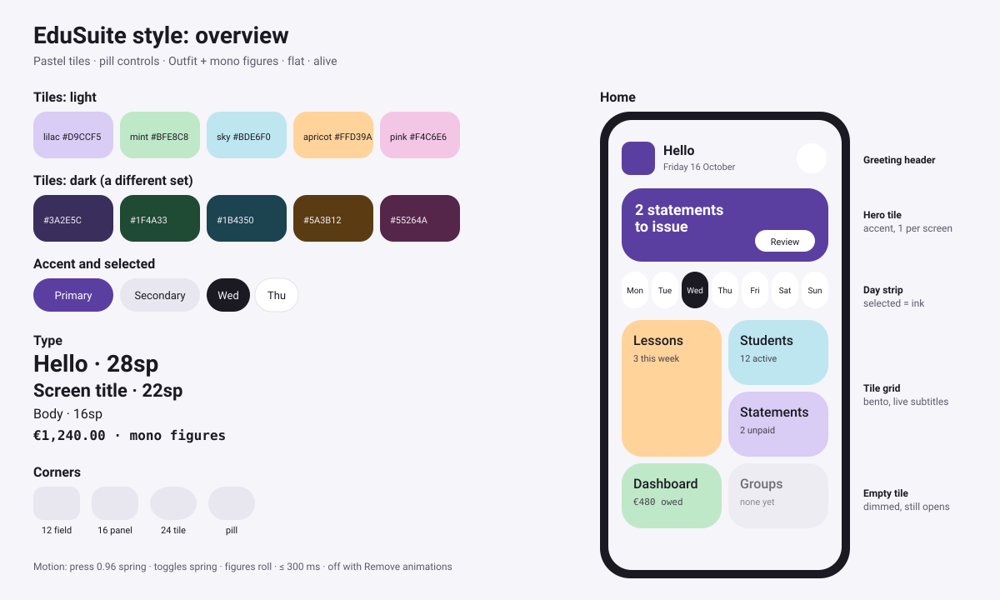

# EduSuite style guide

The shared look and feel of the EduSuite apps: Course Invoicer and Course Pacer. This file is
canonical. Each app keeps a copy, and a change here is made in every copy.

Everything below is shared, except the **Accent** table in §2.4. A new suite app adds one row there
and changes nothing else.



## 1. Principles

- **Alive.** Every touch answers at once with motion, a state change or a haptic tick (§5). The app
  feels responsive, never busy.
- **Friendly and bright.** Soft pastel tiles, generous whitespace and large rounded shapes. Content
  sits in colour blocks, not in boxes.
- **Flat.** No shadows. Colour blocks and hairline dividers separate content.
- **Numbers are legible.** Money, dates and counts use a monospace face, so figures line up and a
  `1` is never mistaken for a `7`.
- **The accent identifies the app.** Wallpaper (dynamic) colour is **off** in every suite app (§11),
  so the same screen always looks the same and the accent tells the apps apart.
- **Tokens, not literals.** Read colours, type and shapes from `MaterialTheme` or the app's extras
  (`Invoicer.colors`). A hex code or a dp value appears only in the theme files.
- **Compose conventions.** `Modifier` is the first optional parameter of every composable.

```kotlin
// Do
Surface(color = Invoicer.colors.tileMint, shape = MaterialTheme.shapes.large) { … }
// Don't
Surface(color = Color(0xFFBFE8C8), shape = RoundedCornerShape(24.dp)) { … }
```

## 2. Colour

Values are sRGB hex. Contrast ratios follow WCAG 2.x (relative luminance) and were computed for
every pair listed (§2.5).

### 2.1 Neutrals

| Token | Light | Dark | Use | Material 3 slot |
|-------|-------|------|-----|-----------------|
| paper | `#F6F5FA` | `#121118` | Window and screen background | `background`, `surface` |
| surface | `#FFFFFF` | `#1C1B22` | Sheets, list groups, fields | `surfaceContainerLow` |
| surfaceContainer | `#E8E6EF` | `#2A2832` | Neutral tiles, bars, unselected chips | `surfaceContainer` (High and Highest the same) |
| line | `#E4E2EA` | `#2E2C37` | Hairline dividers (decorative) | `outlineVariant` |
| outline | `#7A7686` | `#8C889A` | Text-field and control outlines | `outline` |
| muted | `#5E5A6B` | `#A9A5B5` | Secondary text on paper and surface | `onSurfaceVariant` |
| ink | `#1B1A22` | `#ECEAF2` | Body text, titles, the **selected** fill | `onBackground`, `onSurface`, `inverseSurface` |

### 2.2 Tiles

Tiles are the main building block (§6). The suite shares one set; the accent table (§2.4) adds the
app's own. Dark mode uses a **different combination**: deep, low-light versions of each hue with
light text, not the light pastels dimmed.

| Token | Light | Dark |
|-------|-------|------|
| tileLilac | `#D9CCF5` | `#3A2E5C` |
| tileMint | `#BFE8C8` | `#1F4A33` |
| tileSky | `#BDE6F0` | `#1B4350` |
| tileApricot | `#FFD39A` | `#5A3B12` |
| tilePink | `#F4C6E6` | `#55264A` |
| onTile (text and icons) | `#1B1A22` | `#F3F1F8` |
| onTileMuted (secondary text) | `#46424F` | `#D6D2E0` |

- A screen uses at most **three** tile hues side by side, so the colour stays cheerful, not noisy.
- One **hero tile** per screen may use the accent fill with on-accent text (the mock-up's purple
  *Daily challenge* card).
- Mint means paid or done and apricot means due soon wherever the meaning matters; the words still
  say it (§7).
- **Selected** state (a day chip, a filter) is an ink fill with paper text.

### 2.3 Semantic colours

| Token | Light | Dark | Use | Material 3 slot |
|-------|-------|------|-----|-----------------|
| warn (rust) | `#9E4A24` | `#EE9C78` | Overdue, unpaid, errors | `error` |
| on warn | `#FFFFFF` | `#3E1A0A` | Text on warn | `onError` |
| warnSoft | `#F7E4DA` | `#3D2419` | Warning banners and chips | `errorContainer` |
| on warnSoft | `#3E1A0A` | `#F7E4DA` | Text on warnSoft | `onErrorContainer` |
| ok (moss) | `#3E6E47` | `#8FC79A` | Paid, done, on track | `tertiary` |
| on ok | `#FFFFFF` | `#0F2A17` | Text on ok | `onTertiary` |
| okSoft | `#DCEBDF` | `#1D3424` | Success chips | `tertiaryContainer` |
| on okSoft | `#15321C` | `#DCEBDF` | Text on okSoft | `onTertiaryContainer` |

### 2.4 Accent (the only per-app values)

| App | Accent light | Accent dark | On accent (light / dark) | accentSoft (light / dark) | On accentSoft (light / dark) |
|-----|--------------|-------------|--------------------------|---------------------------|------------------------------|
| Course Pacer | `#245E60` teal | `#6FB3AE` | `#FFFFFF` / `#0F2E2F` | `#D5EAE8` / `#163C3C` | `#0F2E2F` / `#D5EAE8` |
| Course Invoicer | `#5B3FA0` purple | `#CDBEFF` | `#FFFFFF` / `#2B1B5E` | `#E9E2FA` / `#3B2D6B` | `#2B1B5E` / `#E9E2FA` |

Accent maps to `primary`, on accent to `onPrimary`, accentSoft to `primaryContainer` and
`secondaryContainer`, and on accentSoft to `onPrimaryContainer` and `onSecondaryContainer`.
`inversePrimary` is the other mode's accent. `secondary` is muted.

The launcher icon tile uses the **light** accent in both modes (§9).

### 2.5 Contrast

Targets: **4.5:1** for text, **3:1** for meaningful UI parts such as field outlines and icons. The
`line` token is decorative and exempt.

| Pair | Light | Dark |
|------|-------|------|
| ink on paper | 15.90 | 15.74 |
| ink on surface | 17.25 | 14.33 |
| ink on surfaceContainer | 13.96 | 12.17 |
| paper on ink (selected) | 15.90 | 15.74 |
| muted on paper | 6.14 | 7.81 |
| muted on surface | 6.67 | 7.11 |
| muted on surfaceContainer | 5.39 | 6.03 |
| outline on paper (UI) | 4.06 | 5.45 |
| outline on surface (UI) | 4.41 | 4.97 |
| onTile on lilac / mint / sky / apricot / pink | 11.42 / 12.81 / 12.93 / 12.35 / 11.55 | 10.87 / 8.99 / 9.54 / 9.06 / 10.64 |
| onTileMuted on lilac / mint / sky / apricot / pink | 6.46 / 7.24 / 7.31 / 6.99 / 6.53 | 8.20 / 6.79 / 7.20 / 6.84 / 8.03 |
| Invoicer accent on tileLilac | 5.22 | 7.19 |
| warn on paper | 5.60 | 8.63 |
| ok on paper | 5.49 | 9.65 |
| warn on warnSoft | 4.93 | 6.60 |
| ok on okSoft | 4.82 | 6.89 |
| on warnSoft on warnSoft | 12.58 | 11.65 |
| on okSoft on okSoft | 11.29 | 10.83 |
| Invoicer accent on paper | 7.27 | 11.09 |
| Invoicer accent on surface | 7.88 | 10.09 |
| on accent on Invoicer accent | 7.88 | 8.73 |
| on accentSoft on Invoicer accentSoft | 11.77 | 9.43 |
| Icon paper `#F6F5FA` on Invoicer tile `#5B3FA0` | 7.27 | (same tile) |

`muted` is for paper and surface only. On a tile, secondary text uses `onTileMuted`: `muted`
drops to 4.2:1 on some dark tiles. Course Pacer's accent pairs are listed in its own copy and must
be re-checked against the new paper and surface values.

## 3. Type

One bundled geometric sans, **Outfit** (SIL Open Font License), in Regular, Medium and SemiBold, as
`res/font` files (about 150 KB). Figures stay monospace.

| Role | Style | Weight | Size |
|------|-------|--------|------|
| Home greeting | `headlineMedium` | SemiBold | 28sp / 36sp line |
| Screen title | `titleLarge` | SemiBold | 22sp / 28sp |
| Tile and dialog titles | `headlineSmall` | Medium | 20sp / 26sp |
| Card and row titles | `titleMedium` | Medium | 16sp / 22sp |
| Body | `bodyLarge` / `bodyMedium` | Regular | 16 / 14sp |
| Secondary details | `bodySmall` | Regular | 12sp |
| Chips, labels, eyebrows | `labelLarge` / `labelMedium` / `labelSmall` | Medium | 14 / 12 / 11sp |
| Money, dates, counts | any style | `FontFamily.Monospace`, SemiBold for headline figures | as the surrounding style |

- Mono is for figures only, never for whole sentences. A label next to a figure stays in sans.
- Text sizes are in sp so they follow the user's font scale. Layouts must survive 200%.

## 4. Shape, spacing, elevation

| Element | Corners | M3 slot |
|---------|---------|---------|
| Text fields | 12dp | `small` |
| List groups, panels, stat tiles | 16dp | `medium` |
| Tiles, hero tile | 24dp | `large` |
| Dialogs and bottom sheets (top corners) | 28dp | `extraLarge` |
| Chips, buttons, day chips, icon-button backgrounds | pill (50%) | `CircleShape` / `extraSmall` set to 50% |
| Logo tile | a quarter of its size (22dp at 88dp) | — |

**Spacing** stays on a 4dp grid:

| Value | Token | Use |
|-------|-------|-----|
| 4dp | `Space.xs` | Icon-to-text gaps, between stacked text lines |
| 8dp | `Space.s` | Between tiles in a grid, between chips |
| 12dp | `Space.m` | Inside chips and rows, between list items |
| 16dp | `Space.l` | Screen edges, tile padding |
| 24dp | `Space.xl` | Between sections |
| 32dp | `Space.xxl` | Above the home header, empty-state padding |

**Elevation:** flat. No shadows and no tonal elevation. Material components that elevate by default
(menus, dialogs) keep their surface colour; a sheet is set apart by its scrim.

## 5. Motion and micro-interactions

Motion makes the app feel alive and confirms what happened. It never decorates.

**Shared specs** (one `Motion` object in each app's theme):

| Spec | Value | Use |
|------|-------|-----|
| `Motion.bouncy` | `spring(dampingRatio = 0.6f, stiffness = Spring.StiffnessMedium)` | State changes: press, toggle, selection |
| `Motion.settle` | `spring(dampingRatio = 1f, stiffness = Spring.StiffnessMediumLow)` | Sizes and positions |
| `Motion.quick` | `tween(150, easing = FastOutSlowInEasing)` | Colour and alpha changes |
| `Motion.content` | `tween(250, easing = FastOutSlowInEasing)` | Content that appears or expands |
| `Motion.screen` | `tween(300, easing = FastOutSlowInEasing)` | Screen push and pop |

**Per control:**

- **Buttons and tiles:** on press they scale to 0.96 and spring back (`Motion.bouncy`); the ripple
  takes the tile's `onTile` colour at low alpha. A primary *Save* morphs into a ✓ for 600 ms, then
  the screen closes or the button returns.
- **Switch:** the thumb springs across, the track cross-fades its colour, the thumb icon changes
  from ✕ to ✓, and a light haptic tick (`HapticFeedbackType.ToggleOn` / `ToggleOff`).
- **Slider** (lesson duration, fee steps): while dragging, a value bubble pops up above the thumb
  in mono; a haptic tick on each step (`SegmentTick`); the thumb grows by 20% while pressed.
- **Checkbox and *Mark paid*:** the check mark draws itself as a path (`Motion.content`). A figure
  that becomes paid cross-fades to ok colour with a 1.0 → 1.08 → 1.0 pulse.
- **Chips and day strip:** the selected ink fill slides from the old chip to the new one, as one
  shared indicator; it never jumps.
- **Figures:** money and counts roll when they change: the new value slides in from below when it
  rises and from above when it falls (`AnimatedContent`).
- **Lists:** rows use `Modifier.animateItem()` for insert, remove and reorder. A swiped row reveals
  its action behind it with resistance, and the action's icon scales up once past the threshold.
- **Expand and collapse:** `animateContentSize(Motion.settle)` with a chevron that rotates 180°.
- **Text fields:** the outline animates to the accent on focus; an error shakes the field once
  (3 × 4dp, 300 ms) with a `Reject` haptic.
- **Screens:** a shared-axis horizontal slide plus fade on push and pop (`Motion.screen`). A Home
  tile may expand into its screen (container transform) where the screen has one obvious source.
- **Snackbars:** slide up; the *Undo* countdown is a thin bar that empties.

**Rules:**

- No looping, idle or attention-seeking animation. Nothing moves unless the user or the data did.
- No transition longer than 300 ms. Springs settle within the same time.
- When the system's *Remove animations* is on (animator duration scale 0), every animation jumps to
  its end state. Haptics follow the system's touch-feedback setting.
- Motion never carries information alone: the state it shows is also visible when it ends.

## 6. Components

These are behaviours, not code: each app implements them in its own code.

- **Tile.** The base block: a tile colour (§2.2), 24dp corners, 16dp padding, no border. Optional
  status chip at the top, a title (`headlineSmall`), details in `onTileMuted`, and a figure or icon.
  The whole tile is one touch target with the press motion (§5).
- **Tile grid (Home).** Each section of the app is a tile in a 2-column grid of mixed heights (a
  bento): the most-used sections are tall, the rest are short. Each tile carries a **live subtitle**
  with the current count or next step (*3 lessons this week*). An empty section's tile **dims**:
  background at 30%, text and icon at 60%; it still opens so the user can add the first item. At
  200% font scale or under 360dp width the grid becomes one column.
- **Hero tile.** At most one per screen, in the accent fill: the one thing to do next (for example
  *2 statements to issue*), with a pill action button in surface colour.
- **Stat tile row.** Two or three tiles side by side, each in its own tint, 16dp corners: a label in
  `bodySmall` over a figure in mono SemiBold `titleLarge` with its unit in sans (*€480* · *12
  lessons*).
- **Day strip.** Seven pill day chips (weekday over date, date in mono). Today has a small dot
  above the weekday; the selected day has the ink fill; days with lessons have a dot below. The
  strip scrolls by week with a swipe.
- **Status chip.** A pill in surface colour at 70% on a tile, or a tile tint on paper, `labelSmall`
  Medium: *Unpaid*, *Paid*, *Draft*.
- **List row.** A leading outlined icon, a title (`titleMedium`), a muted subtitle, and a trailing
  chevron or value; rows are grouped on a 16dp-corner surface with hairline `line` dividers inset to
  the text.
- **Section.** An Eyebrow, an optional trailing text action (*See all*), then the content, 8dp
  apart. Sections are 24dp apart.
- **Eyebrow.** `labelMedium` Medium in muted, sentence case. It is marked as a heading for TalkBack.
- **Buttons.** Pill shaped, 48dp tall. Primary: accent fill. Secondary: surfaceContainer fill with
  ink text. Tertiary: text only in accent. Icon buttons sit on a 40dp pill in surface colour inside
  a 48dp target.
- **Switch, slider, checkbox.** Material 3 components themed with the accent, with the motion in §5.
- **Bottom sheet.** For short edits (three fields or fewer) and pickers. Top corners 28dp, a drag
  handle, the primary action at the bottom.
- **EmptyState.** A 120dp circle in a tile tint holding a 48dp icon in `onTile`, a title, a one-line
  muted message and a pill action button. Centred, 16dp between parts.
- **CommitField.** A text field for a setting or a value that saves itself. It keeps exactly what the
  user typed, commits a value only when it is valid, and waits 400 ms after the last keystroke
  before committing. An invalid entry shows its reason under the field and is never saved.
- **Warning banner.** A full-width warnSoft block (16dp corners) with on-warnSoft text, an optional
  leading warn icon and an optional text action. Use it for something the user should act on soon
  (an overdue statement, an old backup). Errors from an action go in a snackbar instead.
- **GuideCard.** A short how-to on a tile: a title, one or two lines of `onTileMuted` text, an
  optional text action and an optional dismiss (×) button. It explains, it never blocks.

### Home header

Identical in every suite app, at the top of the home screen, left-aligned:

1. The logo tile, 48dp, at the start.
2. Next to it, two lines: **Hello** (`headlineSmall`, ink) and today's date (`bodyMedium`, muted,
   for example *Friday 16 October*).
3. At the end, a 40dp pill icon button (Settings).

Below it, *part of EduSuite apps* in `bodySmall` italic muted, once, under the tile grid.

## 7. Accessibility

- Text contrast at least **4.5:1**; meaningful UI parts (field outlines, icons that carry meaning,
  focus indicators) at least **3:1** (§2.5).
- Touch targets at least **48 × 48dp**, even when the visible control is smaller.
- Every icon that acts has a TalkBack label (the action, such as *Delete lesson*); decorative icons
  and the logo have none.
- Screen titles, eyebrows and tile titles are marked as headings. A tile reads as one item: title,
  subtitle and figure together.
- Colour is never the only signal: a warn figure also says *Overdue* or *Unpaid* in words.
- Swipe actions also exist in the row's long-press menu and as TalkBack custom actions.
- Layouts work at 200% font size and in landscape.

## 8. Copy tone

- Plain, short and warm. Say what happened or what to do: *Lesson saved*, *Add a student first*.
- Sentence case for titles, buttons and labels. Never title case, never all caps.
- No exclamation marks, no jokes, no blame. Errors say what to change.
- Use the user's words (lesson, student, statement, payment), not database terms.

## 9. Launcher icon

- A **108dp adaptive icon** made of vectors only; no bitmap mipmaps.
- **Background:** a solid tile in the app's **light** accent, in both light and dark mode.
- **Foreground:** an **open book** in the light paper colour (`#F6F5FA`), two slightly curved pages
  with a thin gap for the spine. The app's glyph is on the **right page**:
  - Course Pacer: three pacing lines in the accent.
  - Course Invoicer: a bold euro sign (€) in the accent.
- Draw the glyph as a **hole** in the page (even-odd fill), not as a second colour. The accent tile
  then shows through it, and the **same vector** serves as the monochrome (themed icon) layer.
- All art stays inside the **66dp safe-zone circle** centred in the 108dp canvas.
- The in-app Logo draws the same foreground at 1.5×, clipped to its rounded tile.

## 10. Dark theme

- Every token has a dark value (§2). Dark paper is a near-black violet, never pure black, and ink is
  off-white, never pure white.
- Tiles switch to their deep set (§2.2) with light text. The accent gets lighter, and text on it gets
  dark.
- The user picks System, Light or Dark in Settings, and the system bars follow that choice. The
  window background shown before the first frame is the paper colour of the system's mode.
- Check every contrast pair again when a dark value changes.

## 11. Dynamic colour

Off in every suite app. Material You's wallpaper colours would replace the accent and the tiles, and
the accent is what identifies the app. The themes build their colour schemes only from the tokens
above.

## 12. States

- **Loading.** Most screens read a local database and need no loading state. Anything slower than
  1 s shows a static placeholder in surfaceContainer with the final layout's shape; no looping
  shimmer (§5).
- **Empty.** EmptyState (§6), with the action that fills the list.
- **Error.** The result of an action goes in a snackbar, a lasting problem in a warning banner.
  Messages come from the domain layer and say what to change.

```kotlin
// Do
MessageEffect(state.message, snackbarHostState, viewModel::messageShown)
// Don't
if (state.message != null) AlertDialog(…)   // a dialog blocks for something the user cannot act on
```

## 13. Strings and icons

- All user-visible text, `contentDescription` included, comes from `strings.xml` through
  `stringResource()`.
- Icons are **outlined, rounded** Material Symbols, drawn as vectors. Directional icons (back,
  chevrons) use the `AutoMirrored` set.
- An icon that acts sits in an `IconButton` (48dp target) with a localised label.

```kotlin
Text(stringResource(R.string.save))   // Do
Text("Save")                          // Don't
```

## 14. Flow

Rules that keep the everyday work fluid: few taps and no dead ends.

- **Two taps to the daily work.** From Home, *Log lesson* and *Mark paid* take two taps at most.
- **Undo over confirm.** A reversible action (delete a lesson, mark paid, archive a student) happens
  at once and offers *Undo* in a snackbar for 5 s. A confirm dialog is only for what cannot be
  undone (void a statement, restore a backup).
- **Smart defaults.** A new lesson takes its date, time, duration and rate from the student's last
  lesson. A form opens with the keyboard on its first empty field; the keyboard's *Next* moves
  between fields and *Done* saves.
- **Act in place.** Swipe a row to mark it paid or delete it; long-press for more. Short edits open
  in a bottom sheet over the list instead of a new screen.
- **Progressive disclosure.** Rarely used fields sit behind *More options*, which expands in place.
- **Always a next step.** Every empty state, snackbar and finished task offers the obvious next
  action (*Statement issued* → *Share*).
- **Keep the user's place.** Back returns to the same scroll position, filter and selected day.
- **Feedback within 100 ms** for every touch (§5), and visible progress for anything slower than
  1 s.

## 15. Not used

- **Bottom navigation bar.** Home is the launcher and every other screen has a Back arrow.
- **Photos and 3D illustrations.** They add APK size and licensing questions; tiles carry icons.
- **Avatars.** Students have no pictures; a tile or row shows initials only if it needs an anchor.
- **More than three tile hues on one screen**, and any colour outside §2.
