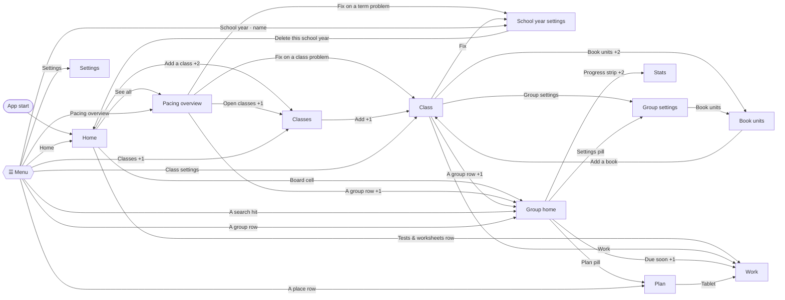

# Navigation and interaction map

Every control in Course Pacer: the gesture it takes, when it is there, and what happens next. Every interaction over the screens, sheets, menus, dialogs and panels, read from `app/src/main/java/gr/edusuite/pacer/ui/`. The back-stack rules themselves are in [ARCHITECTURE.md](ARCHITECTURE.md) (Navigation).

Read it before changing any screen, and change it in the same pull request as the control (see `CLAUDE.md`). Labels are the app's English strings; *name* and *N* stand for values the app fills in.

**What happens** starts with the result: **→ Screen** pushes a screen, **↑ Opens** a sheet, menu or dialog over it, **Undo:** a message with Undo, **Message:** one without, **Edit** a change saved at once, **View** a change to what is shown only, **Leaves app** for Android or the browser, **Closes**.

## Screen graph

Screens only, with the control that pushes each (+N: more controls lead the same way). ☰ Menu is available on every screen. Sheets and menus are in the tables below.

## Findings

- **Deletes have no confirmation.** Deleting a school year, a class or a group happens at once; Undo in the message is the only way back.
- **Creating or switching a school year clears Undo history.**
- **Home is the only root.** Launch ignores the saved group; groups swap rather than stack.

## Everywhere

### Top bar

*Rules*. Shown on every screen except Home, which has its own header with ☰. On a tablet the list pane has only its title; the actions sit in the detail pane's bar.

| Control | Gesture | When | What happens |
| --- | --- | --- | --- |
| ☰ Menu | Tap | Below 840dp wide, or on a wider tablet while the menu is unpinned; read as “Menu, update available” while an update waits | ↑ Opens [☰ Menu](#drawer). Slides the menu in over the screen. The update dot is the mark colour, 3:1 on every palette. |
| Context line and title | Shows |  | Small line names the year (or year · class); the title names the screen, class or group. The line is plain text, not a link; the menu's Classes & Groups list is the way up. |
| Title ▾ (Switch group) | Tap | Group screens only | ↑ Opens [Go to](#group-switcher). One sheet from every group page. |
| ⚠ N warnings | Tap | Group screens, while the count is above 0 and the bar has room | ↑ Opens [Warnings · Class · Group](#warnings). Opens the group's Warnings sheet. |
| ⚠ N (year problems) | Tap | Pacing overview | ↑ Opens [Problems in this year](#year-problems). Opens Problems in this year. |
| ⚠ N (class problems) | Tap | Class | ↑ Opens [Problems in this class](#class-problems). Opens Problems in this class. |
| Undo / Undo (N) | Tap | Classes, Class, School year settings, Units and every group screen, while the bar has room. Greyed out at 0 | Edit. Steps back one edit. The number is how many steps are left. |
| ⋮ More options | Tap | Group screens; on other screens only while the bar has folded Undo or warnings | ↑ Opens [⋮ Group menu](#group-menu). Opens the group menu; read as “More options, N warnings” while it holds a folded count. |
| Folded Undo and warnings | Automatic | The title and the buttons don't fit (a long name, a narrow bar, large text) | View. Undo and ⚠ N move to the top of ⋮, which carries the warning count on a badge. The title is cut only when even that doesn't fit. |

### ☰ Menu

*Panel* · reached from [Top bar](#top-bar), [Home](#home). A drawer that slides over the screen; from 840dp it can stay open beside the screens (pinned, the default) and ☰ goes away. Swiping only closes it, so an edge swipe never fights the month pager or system Back. The five main items never change order: Home, Pacing overview, Classes & Groups, School year, Settings, each with an icon. Every row that opens a screen closes the drawer and uses goTo: a screen already open is returned to, not stacked again.

**Classes & Groups** is the “You are here” list. It opens at the teacher's own place and shows one level at a time, each hiding the ones above it:

- on Classes: the classes (with group counts) and All N classes;
- on Class or Units: that class's Class settings and groups, under a back row to the classes;
- on a group page: that group's five places, with the current one marked, under a back row to the class.

Nested rows are indented and carry no icon. The row on the screen the teacher is on is highlighted and read as “Current page”. Moving inside Classes & Groups moves the list with the teacher; opening Home, Pacing overview, School year or Settings leaves a pinned menu as it was.

| Control | Gesture | When | What happens |
| --- | --- | --- | --- |
| 📌 Pin / unpin the menu | Tap | Window 840dp wide or more | Edit. Pinned keeps the menu open beside the screens. Unpinned collapses it behind ☰ and it slides over the screen like a phone's. Kept in Settings (`drawerPinned`). Read as “Keep the menu open” / “Let the menu collapse”. |
| Find a class or group | Type | While a school year is open | View. Lists every group whose class and group names hold each word you type. Accents and case are ignored, so “Fce” finds “FCE”. Each hit shows its status. |
| ✕ Clear search | Tap | While there is text | View. Empties the field and brings the menu items back. |
| A search hit (Class · Group) | Tap |  | → Screen [Group home](#group-home). Opens that group's home, switching the open class if needed. |
| No class or group matches “…” | Shows | Search found nothing | Message only. |
| Home | Tap |  | → Screen [Home](#home). Clears the stack back to Home. |
| Pacing overview (N behind) | Tap | While a year is open | → Screen [Pacing overview](#overview). Opens Pacing overview. The count is groups behind. |
| Classes & Groups | Tap | Year has no classes | → Screen [Classes](#classes). Opens Classes, where the first one is added. |
| Classes & Groups ⌄ / ⌃ | Tap | Year has classes | View. Shows or hides the list, which starts at the teacher's own place each time the menu opens (read as Show / Hide classes and groups). |
| A class row (with group count and ›) | Tap | Classes level | View. Opens that class's groups in the list; the other classes disappear. |
| All N classes | Tap | Classes level | → Screen [Classes](#classes). Opens Classes. |
| ‹ Classes / ‹ Class name (back row) | Tap | Class and group levels | View. Goes up one level of the list without leaving the screen (read as “Back to …”). |
| Class settings | Tap | Class level | → Screen [Class](#class). Opens that class. |
| A group row (with status) | Tap | Class level | → Screen [Group home](#group-home). Opens that group's home and closes the menu. |
| Group home · Plan · Work · Stats · Group settings | Tap | Group level | → Screen [Group home](#group-home) / [Plan](#plan) / [Work](#work) / [Stats](#stats) / [Group settings](#group-settings). Opens that place of the group. On a tablet Group home is not listed twice: it is shown as Plan. |
| School year · short name | Tap | While a year is open | → Screen [School year settings](#school-year). Opens School year settings. A long name is shortened (“2026–2027” becomes “2026–27”). |
| Settings (Update tag) | Tap |  | → Screen [Settings](#app-settings). Opens Settings. The tag shows while an update is available. |
| Swipe the drawer away / tap outside / Back | Swipe |  | Closes. Closes the drawer. |

### Messages and Undo

*Rules*. One message at a time slides up from the bottom; a new one replaces the old. Messages that follow an edit carry Undo, kept on screen longer when the phone's accessibility timeout asks for it.

| Control | Gesture | When | What happens |
| --- | --- | --- | --- |
| Undo (in the message) | Tap | Until the message times out, another edit happens, or the year switches | Edit. Reverts exactly the change the message names. A later edit makes this Undo stale, and the message closes. |
| “Already up to date” | Shows |  | Message:. Shown instead of an Undo message when a fix (re-pace, tidy, catch-up…) changes nothing. |
| “Your school years couldn't be read” notice | Automatic | When the saved file fails to load | ↑ Opens [Your school years couldn't be read](#recovery). A message at start; the recovery dialog opens if a copy was set aside. |

### Back, windows and start

*Rules*. Rules that apply on every screen.

| Control | Gesture | When | What happens |
| --- | --- | --- | --- |
| System Back / back gesture | Back |  | Closes. Closes, in order: an open menu or sheet, the drawer, then the top screen. In a two-pane window it closes the detail pane first. Home is the root, so Back on Home leaves the app. |
| App start | Automatic |  | → Screen [Home](#home). Always opens Home. The last open group is saved but not reopened. |
| Opening another group from a group | Automatic |  | → Screen. Replaces the group on the stack instead of stacking groups, so Back never walks through a chain of groups. |
| Switching year | Automatic |  | Edit. Closes every screen of the old year and clears Undo history. |
| Switching class | Automatic |  | → Screen. Closes the old class's screens; the year's screens stay. |
| Deleting or undoing something | Automatic |  | → Screen. Screens for a year, class or group that no longer exists drop off the stack. |
| Tablet 600–839dp | Automatic |  | View. Pacing overview (or Classes) shows as a list pane beside the open group; with no group open the right pane says to pick one. Group home shows as Plan. |
| Tablet 840dp and wider | Automatic |  | View. The menu stays open on the left while it is pinned (no ☰); unpinned, it collapses behind ☰. |
| Midnight / returning to the app | Automatic |  | View. “Today” refreshes, so Today and Next labels and overdue lessons move on by themselves. |

### Go to

*Sheet* · reached from [Top bar](#top-bar). Opened by the title ▾ on group home, Plan, Work, Stats and Group settings. A bottom sheet; swipe down, tap outside or Back to close. One sheet for every page: the open group's places first, then the open class's other groups.

| Control | Gesture | When | What happens |
| --- | --- | --- | --- |
| Group home · Plan · Work · Stats · Group settings | Tap |  | → Screen [Group home](#group-home) / [Plan](#plan) / [Work](#work) / [Stats](#stats) / [Group settings](#group-settings). Opens that place; the one you are on is ticked and read as “Current page”. On a tablet Group home is left out (it is shown as Plan). |
| The open class's other groups (with status) | Tap | The class has other groups | → Screen [Group home](#group-home). Opens that group's home. |

### Date picker

*Dialog* · reached from [New school year](#new-year), [Term](#term), [Add a day off](#day-off), [Book (editor)](#book-editor), [Group (editor)](#group-editor), [Add extra lesson… / Edit extra lesson…](#extra-lesson), [Add assignment / Edit assignment](#assignment), [Group settings](#group-settings), [Add a day off / Edit day off](#group-day-off), [Book options (group)](#book-options). Every date field opens this Material calendar dialog.

| Control | Gesture | When | What happens |
| --- | --- | --- | --- |
| A day in the calendar / month arrows / year list / ✎ type a date | Tap |  | View. Chooses the date shown. |
| OK | Tap |  | Edit. Saves the chosen date into the field. |
| Clear | Tap | Only on optional fields that hold a date | Edit. Empties the field (for example, back to the class or term default). |
| Cancel | Tap |  | Closes. Closes without a change. |

### How fields and sheets save

*Rules*. Behaviour shared by every form.

| Control | Gesture | When | What happens |
| --- | --- | --- | --- |
| Text and number fields on screens and Done sheets | Type |  | Edit. Save as you type whenever the value is valid; an invalid value shows its error and isn't saved. |
| Pick-from-list fields (Picker) | Tap |  | Edit. Open a dropdown of choices; picking one saves it. |
| Bottom sheet: Save / Add / Apply | Tap |  | Edit. Greyed out until the form is valid. Saves, shows a short Saved tick, then closes. |
| Bottom sheet: Done | Tap |  | Closes. Closes. Its fields were already saved as you typed. |
| Swipe a sheet down / tap outside / Back | Swipe |  | Closes. Closes without saving whatever needed Save. |
| Full-height work sheets (assignment, units, revision): ✕ Close | Tap |  | Closes. Closes. Tapping the dimmed area does the same. |
| Swipe a removable row from the end | Swipe |  | Undo:. Reveals Remove and removes the row (days off, assignments), with Undo. The same Remove is in its long-press menu and TalkBack actions. |

## Year

### Home

*Screen* · reached from [☰ Menu](#drawer), [Back, windows and start](#system), [School year settings](#school-year). The root of the stack. A greeting (Hello, or Hello, your name), today's date and the year, then the Pacing overview board and the next tests and worksheets.

| Control | Gesture | When | What happens |
| --- | --- | --- | --- |
| ☰ | Tap | Below 840dp | ↑ Opens [☰ Menu](#drawer). Opens the menu. |
| Welcome page | Automatic | First run | ↑ Opens [Welcome to Course Pacer](#welcome). Opens over Home once. |
| New school year | Tap | No school year yet | ↑ Opens [New school year](#new-year). Opens the New school year dialog. |
| Add a class | Tap | Year without classes | → Screen [Classes](#classes). Opens Classes. |
| Pacing overview board: a cell (Group, −N when behind; “● Today” under the name when the group has a lesson today) | Tap |  | → Screen [Group home](#group-home). Opens that group's home. The dot blinks three times when Home opens, then stays lit (steady with animations off). Groups run most behind first inside each class, as on Pacing overview. TalkBack reads class, group, “on pace” or “short by N lessons”, and “has a lesson today”. |
| See all › / N groups on pace › / N set-up needed › | Tap | The large-text board counts only measured groups as on pace; groups with nothing to measure are “set-up needed” | → Screen [Pacing overview](#overview). Opens Pacing overview. |
| Legend (on pace · behind, lessons short · Today) | Shows |  | Explains the board; each swatch looks like its cell, and the dot blinks like the cells'. |
| Tests & worksheets card: a row (date, title, class · group, kind) | Tap | Some test or worksheet is still to come; the card is hidden otherwise | → Screen [Work](#work). Opens the Work page of its group (the class's first group for a test that is for every group; the Class screen if it has none). Shows the next four. |

### Welcome to Course Pacer

*Dialog* · reached from [Home](#home), [Settings](#app-settings). A full-screen dialog: what the app does and four steps to a first schedule. Also opened by Settings › Getting started.

| Control | Gesture | When | What happens |
| --- | --- | --- | --- |
| Create your school year | Tap | From Home on first run | ↑ Opens [New school year](#new-year). Closes the guide and opens New school year. |
| Not now | Tap | From Home | Closes. Closes the guide for good. |
| Got it | Tap | From Settings | Closes. Closes the guide. |

### New school year

*Dialog* · reached from [Home](#home), [Welcome to Course Pacer](#welcome), [School year settings](#school-year). Opened from Home (no year yet), the welcome page, or New school year on School year settings.

| Control | Gesture | When | What happens |
| --- | --- | --- | --- |
| Name | Type |  | Required. The placeholder suggests a name. |
| Starts / Ends | Tap |  | ↑ Opens [Date picker](#date-picker). Open the date picker. |
| Add the Greek public holidays as days off (the box or its words) | Toggle |  | Adds the holidays between the two dates. Needs both dates. The whole row is one checkbox for TalkBack. |
| Create | Tap | Name filled in | Edit. Creates the year and opens it. Undo history starts fresh. |
| Cancel | Tap |  | Closes. Closes. |

### Pacing overview

*Screen* · reached from [☰ Menu](#drawer), [Home](#home). Every group in every class of the year, by class. On a tablet it is the list pane, with the selected group highlighted.

| Control | Gesture | When | What happens |
| --- | --- | --- | --- |
| Open classes | Tap | No classes yet | → Screen [Classes](#classes). Opens Classes. |
| Groups: sort button | Tap |  | ↑ Opens [Groups: sort](#overview-sort). Opens the sort menu. |
| A group row (next lesson, lessons left, status) | Tap |  | → Screen [Group home](#group-home). Opens that group (on a tablet, in the detail pane). |
| N on pace › / Hide groups on pace | Tap | Per class | View. Shows or folds that class's on-pace groups. |
| N classes all on pace › / Hide groups on pace | Tap |  | View. Shows or folds the classes whose groups are all on pace. |
| ⚠ in the top bar | Tap | Year has problems | ↑ Opens [Problems in this year](#year-problems). Opens Problems in this year. |

### Groups: sort

*Menu* · reached from [Pacing overview](#overview). Dropdown from the sort button.

| Control | Gesture | When | What happens |
| --- | --- | --- | --- |
| most behind first | Tap |  | View. Sorts groups by lessons short. |
| by name | Tap |  | View. Sorts groups by name. |
| by next lesson | Tap |  | View. Sorts groups by their next lesson date. |

### Problems in this year

*Sheet* · reached from [Top bar](#top-bar), [Pacing overview](#overview). Term problems once, then each class's problems prefixed with its name. Empty: “Nothing needs your attention.”

| Control | Gesture | When | What happens |
| --- | --- | --- | --- |
| Fix on a term problem (Set both a term…, The term ends…) | Tap |  | → Screen [School year settings](#school-year). Opens School year settings. |
| Fix on a class problem (books, groups) | Tap |  | → Screen [Class](#class). Opens that class. |
| Fix on a group's plan problem | Tap |  | → Screen [Group home](#group-home). Opens that group. |
| Fix on “Add at least one class.” | Tap |  | → Screen [Classes](#classes). Opens Classes. |

### Classes

*Screen* · reached from [☰ Menu](#drawer), [Home](#home), [Pacing overview](#overview), [Problems in this year](#year-problems). The year's classes, by collection when there are collections. Each row shows its groups and book count, with a tag when groups are behind or the class has problems.

| Control | Gesture | When | What happens |
| --- | --- | --- | --- |
| New class (empty state, or the floating button) | Tap |  | ↑ Opens [New class](#new-class). Opens the New class sheet. |
| Classes: sort button (Your order / Name / Most behind) | Tap |  | ↑ Opens [Classes: order](#class-order). Opens the order menu. |
| A class row | Tap |  | → Screen [Class](#class). Opens that class. |
| A collection's ⋮ (Edit collection) | Tap |  | ↑ Opens [Collection ⋮](#collection-menu). Opens the collection menu. |
| New collection… | Tap |  | ↑ Opens [New collection / Edit collection](#collection). Opens the collection sheet, empty. |

### Classes: order

*Menu* · reached from [Classes](#classes). Dropdown; the current choice has a ✓. The choice is kept in Settings.

| Control | Gesture | When | What happens |
| --- | --- | --- | --- |
| Your order | Tap |  | Edit. The order you added them in. |
| Name | Tap |  | Edit. Alphabetical. |
| Most behind | Tap |  | Edit. Classes with the most groups behind first. |

### Collection ⋮

*Menu* · reached from [Classes](#classes)

| Control | Gesture | When | What happens |
| --- | --- | --- | --- |
| Edit collection | Tap |  | ↑ Opens [New collection / Edit collection](#collection). Opens the collection sheet with its name and classes. |
| Delete collection | Tap |  | Deletes the collection; its classes stay. Undo: “Deleted collection “name”” |

### New collection / Edit collection

*Sheet* · reached from [Classes](#classes), [Collection ⋮](#collection-menu)

| Control | Gesture | When | What happens |
| --- | --- | --- | --- |
| Name | Type |  | Required. |
| A class row with its checkbox | Toggle |  | Choose classes. A class from another collection moves here. |
| Save | Tap | Name filled in | Saves the collection. Undo: “Collection saved” |
| Delete collection | Tap | Editing | Deletes it and keeps its classes. Undo: “Deleted collection “name”” |

### New class

*Sheet* · reached from [Classes](#classes)

| Control | Gesture | When | What happens |
| --- | --- | --- | --- |
| Name | Type |  | Placeholder “B1 Senior”. Blank becomes “Class N”. |
| Enable book units? | Toggle |  | Turns book units on for the class from the start. |
| Add | Tap |  | → Screen [Class](#class). Creates the class with Group A on Mon, Wed, Fri and the lesson length and pace from Settings, then opens it. |

### School year settings

*Screen* · reached from [☰ Menu](#drawer), [Problems in this year](#year-problems), [Problems in this class](#class-problems). Term dates, days off, and renaming or deleting the year.

| Control | Gesture | When | What happens |
| --- | --- | --- | --- |
| Year chips | Tap |  | Edit. Switches to that year and stays on this screen. Clears Undo history. |
| New school year | Tap |  | ↑ Opens [New school year](#new-year). Opens the New school year dialog. |
| Term: Edit / the term row | Tap |  | ↑ Opens [Term](#term). Opens the term sheet. |
| Days off: Add | Tap |  | ↑ Opens [Add a day off](#day-off). Opens Add a day off. |
| A day-off row | Swipe |  | Swipe from the end, or long-press for Remove. Undo: “Removed “reason”” |
| Add Greek public holidays | Tap | Both term dates set | Adds the holidays for every calendar year the term touches. Message: “N holidays added / Already there” |
| Rename | Tap |  | ↑ Opens [Rename school year](#rename-year). Opens Rename school year. |
| Delete this school year | Tap |  |  [Home](#home). Deletes it at once, with no confirmation, and returns Home. Undo: “Deleted “name”” |

### Term

*Sheet* · reached from [School year settings](#school-year)

| Control | Gesture | When | What happens |
| --- | --- | --- | --- |
| Starts / Ends | Tap |  | Edit [Date picker](#date-picker). Date pickers with Clear. Saved at once. |
| Error box | Shows | End before start | “Set a start and end date, with the end on or after the start.” |
| Done | Tap |  | Closes. Closes. |

### Add a day off

*Sheet* · reached from [School year settings](#school-year)

| Control | Gesture | When | What happens |
| --- | --- | --- | --- |
| Reason | Type |  | Placeholder “Christmas break”. |
| From / To (optional) | Tap |  | ↑ Opens [Date picker](#date-picker). Date pickers; To makes it a range. |
| Applies to | Choose |  | All groups, a class (all groups), or one group. |
| Add | Tap | From set | Edit. Adds the day off; every affected plan re-paces. |

### Rename school year

*Sheet* · reached from [School year settings](#school-year)

| Control | Gesture | When | What happens |
| --- | --- | --- | --- |
| Name | Type |  | Required. |
| Save | Tap |  | Edit. Renames the year. |

### Settings

*Screen* · reached from [☰ Menu](#drawer). App-wide preferences, backup, help and updates. No Undo button here.

| Control | Gesture | When | What happens |
| --- | --- | --- | --- |
| Updates: Download | Tap | A newer version is available | Leaves app. Opens the APK download in the browser (or copies the link when there is no browser). |
| Updates: See all changes | Tap | A newer version is available | Leaves app. Opens the release page in the browser. |
| Check for updates automatically | Toggle |  | Edit. Once a day, asks GitHub for the latest version. |
| Check now | Tap |  | View. Shows Checking…, then up to date, a new version, or a failure message. |
| Your name | Type |  | Edit. Home greets you by it. |
| Theme: System / Light / Dark | Toggle |  | Edit. Switches the theme at once. |
| Palette cards (Bone / Saffron) | Tap |  | Edit. Chooses the palette. |
| New classes: Class defaults | Tap |  | ↑ Opens [New class defaults](#class-defaults). Opens the defaults sheet. |
| Export… | Tap | At least one year | Leaves app. Opens the system Save dialog with a dated .json name. Message: “Saved name to folder” |
| Import… | Tap |  | Leaves app [Import N school years?](#import). Opens the system file picker; a readable file opens the import dialog. A file over 50 MiB shows “This backup is too large to open (N MB; the limit is M MB).” |
| Getting started | Tap |  | ↑ Opens [Welcome to Course Pacer](#welcome). Opens the welcome guide. |
| Show tips again | Tap |  | Brings back every tip you closed. Message: “Tips will show again” |
| About | Shows |  | Version, storage note, suite and credits. |

### New class defaults

*Sheet* · reached from [Settings](#app-settings)

| Control | Gesture | When | What happens |
| --- | --- | --- | --- |
| Lesson length (min) | Type |  | Saved as you type; new classes only. |
| Pace you can sustain | Type |  | Pages per lesson; new classes only. |
| Done | Tap |  | Closes. Closes. |

### Import N school years?

*Dialog* · reached from [Settings](#app-settings). Names up to five years from the file. Unreadable, empty, newer or oversized files show a message instead.

| Control | Gesture | When | What happens |
| --- | --- | --- | --- |
| Add | Tap |  | Puts them beside the years on this phone. Undo: “Added N school years” |
| Replace all | Tap | The phone already has years | Deletes those and keeps only the file's. Undo: “Replaced your school years with N…” |
| Cancel | Tap |  | Closes. Closes. |

### Your school years couldn't be read

*Dialog* · reached from [Messages and Undo](#messages). Opens at start when the saved file was unreadable and set aside. The original is kept safe.

| Control | Gesture | When | What happens |
| --- | --- | --- | --- |
| Save a copy… | Tap |  | Leaves app. System Save dialog for the unreadable file. Message: “Saved a copy of the unreadable file.” |
| Close | Tap |  | Closes. Closes. |

## Class

### Class

*Screen* · reached from [☰ Menu](#drawer), [Home](#home), [Problems in this year](#year-problems), [Classes](#classes), [New class](#new-class), [Book units](#units). Lesson length and pace, books and groups. Titled with the class name.

| Control | Gesture | When | What happens |
| --- | --- | --- | --- |
| Edit (beside “N min lessons · P pages a lesson”) | Tap |  | ↑ Opens [Class settings](#class-settings). Opens Class settings. |
| Book units (On / Off) | Tap |  | → Screen [Book units](#units). Opens Book units. |
| Add a book (guide card or Books › Add) | Tap |  | ↑ Opens [Add a book](#add-book). Opens Add a book. |
| A book row (pages, skips, finish-by, tags) | Tap |  | ↑ Opens [Book (editor)](#book-editor). Opens the book editor. |
| Lead book | Choose | Two or more core books | Edit. None, or a book the others keep step with. |
| Add group (guide card or Groups › Add) | Tap |  | Edit. Adds “Group B”, “Group C”… on Mon, Wed, Fri. |
| A group row (Next date) | Tap |  | → Screen [Group home](#group-home). Opens that group's home. |
| Edit name (beside a group) | Tap |  | ↑ Opens [Group (editor)](#group-editor). Opens the group editor. |
| Work: a group row | Tap |  | → Screen [Work](#work). Assignments now live in each group; opens that group's Work. |
| Reset all positions | Tap |  | Clears every group's resume page. Undo: “Positions reset” |
| Delete this class | Tap |  | Deletes at once, with no confirmation, and closes its screens. Undo: “Deleted “name”” |
| ⚠ in the top bar | Tap | The class has problems | ↑ Opens [Problems in this class](#class-problems). Opens Problems in this class. |

### Class settings

*Sheet* · reached from [Class](#class)

| Control | Gesture | When | What happens |
| --- | --- | --- | --- |
| Name | Type |  | Saved as you type. |
| Lesson length (min) | Type |  | Saved as you type. |
| Pace you can sustain | Type |  | The benchmark the verdict measures against. |
| Enable book units? | Toggle |  | Turns units on or off for the class. |
| Book units | Tap |  | → Screen [Book units](#units). Closes the sheet and opens Book units. |
| Warn when a book is this many lessons behind | Type | Two or more books | When Bring in step warnings start. |
| Done | Tap |  | Closes. Closes. |

### Add a book

*Sheet* · reached from [Class](#class)

| Control | Gesture | When | What happens |
| --- | --- | --- | --- |
| Title | Type |  | Placeholder “Companion”. |
| Book type | Choose |  | Core types, or Supplementary (never paced; placed by hand). |
| First page / Last page | Type | Core book | Last page required, 1 to the maximum. |
| Pages you'll use | Type | Supplementary book | Pages or ranges, like 4-7, 12. |
| Add | Tap |  | Edit. Adds the book; every group re-paces. |

### Book (editor)

*Sheet* · reached from [Class](#class). Titled with the book's name. Every field saves as you type.

| Control | Gesture | When | What happens |
| --- | --- | --- | --- |
| Title | Type |  | Renames the book. |
| Book type | Choose |  | Changing to or from Supplementary changes which fields show. |
| First page / Last page | Type | Core | The page range. |
| Skip pages | Type | Core | Like 8, 24–27; applies to every group. |
| Finish by | Tap | Core | Edit [Date picker](#date-picker). Date picker with Clear. Only this book re-paces. |
| Units (N units) | Type | Core, units on | Start pages, like 1, 13, 25, 37. |
| Book units | Tap | Core, units on | → Screen [Book units](#units). Opens Book units. |
| Pages you'll use | Type | Supplementary | The pages it can place. |
| Count in the lesson by default | Toggle | Supplementary | Off: new placements come on top of the lesson. |
| Remove book | Tap |  | Closes the sheet and removes the book. Undo: “Removed “name”” |
| Done | Tap |  | Closes. Closes. |

### Group (editor)

*Sheet* · reached from [Class](#class). Titled with the group's name.

| Control | Gesture | When | What happens |
| --- | --- | --- | --- |
| Name | Type |  | Saved as you type. |
| Weekday chips Mon–Sun | Toggle |  | Turns that lesson day on or off; the plan re-paces. |
| Next lesson | Tap |  | Edit [Date picker](#date-picker). Date picker; sets where the group's lessons start. |
| Group settings | Tap |  | → Screen [Group settings](#group-settings). Closes the sheet and opens Group settings. |
| Open schedule | Tap |  | → Screen [Group home](#group-home). Opens the group. |
| Done | Tap |  | Closes. Closes. |

### Problems in this class

*Sheet* · reached from [Top bar](#top-bar), [Class](#class)

| Control | Gesture | When | What happens |
| --- | --- | --- | --- |
| Fix | Tap | Problems fixed elsewhere | → Screen [School year settings](#school-year). Closes the sheet and opens School year settings, or the group whose plan has the problem. |
| Problem with no Fix | Shows |  | Fixed on this screen (books, groups). |

### Book units

*Screen* · reached from [Class](#class), [Class settings](#class-settings), [Book (editor)](#book-editor), [Group settings](#group-settings). Three steps: choose the lead book, set each book's units, link books. Reached from Class, Class settings, the book editor, Group settings and the Warnings sheet.

| Control | Gesture | When | What happens |
| --- | --- | --- | --- |
| Enable book units? | Toggle |  | Edit. Turns units on for the class. |
| Add a book | Tap | No books | → Screen [Class](#class). Goes back to Class. |
| 1 · Lead book | Choose |  | Edit. Chooses the lead book. |
| 2 · A book row / Add units / Edit | Tap |  | ↑ Opens [Unit start pages](#unit-starts). Opens the unit start pages sheet. |
| 3 · A book's link switch | Toggle | Lead book has units | Edit. Links it to the lead book; it must have the same number of units. |
| Add units (on a mismatched book) | Tap |  | ↑ Opens [Unit start pages](#unit-starts). Opens its unit start pages. |
| Don't link | Tap |  | Edit. Clears every link. |

### Unit start pages

*Sheet* · reached from [Book units](#units). Titled with the book's name. Full height, with ✕.

| Control | Gesture | When | What happens |
| --- | --- | --- | --- |
| − Fewer units / + More units | Tap |  | Removes or adds a unit row. |
| Number of units | Type |  | Sets the count directly. |
| Space evenly | Tap |  | Fills the start pages evenly across the book. |
| Unit N start page | Type |  | Each shows where the unit ends. |
| Save | Tap | Pages increase from the first page | Edit. Saves the starts. |

## Group

### Group home

*Screen* · reached from [☰ Menu](#drawer), [Go to](#group-switcher), [Home](#home), [Pacing overview](#overview), [Problems in this year](#year-problems), [Class](#class), [Group (editor)](#group-editor). The group's hub. On a tablet it shows as Plan instead.

| Control | Gesture | When | What happens |
| --- | --- | --- | --- |
| Yesterday line (“Yesterday: taught as planned”, “pages recorded” or “not taught”) | Tap Change | Yesterday's lesson is done | Opens a menu: Record what I taught… (↑ [Pages taught](#pages-taught)) and Lesson didn't happen (asks first, then records it with no pages and moves its pages to later lessons; Undo: “Lesson recorded as not taught”). |
| Today / Next · lesson N box | Long-press |  | ↑ Opens [Lesson menu](#lesson-menu). Opens the lesson menu for that lesson. |
| Done (in the box, the dark button) | Tap | The shown plan is the one in use | Marks the lesson done with a drawn tick. Undo: “Lesson marked done” |
| Pages taught (tap the pages in the box, shown with an edit icon) | Tap | Today or past lesson | ↑ Opens [Pages taught on Fri 23 Oct](#pages-taught). Opens Pages taught for it. TalkBack: a named “Pages taught” action on the pages. |
| Homework (under Done, in the box, the light button) | Tap |  | ↑ Opens [Add homework](#assignment) for that lesson. The same action as the lesson menu's Add homework…. |
| Homework due today / set today lines | Shows |  | Under the box. |
| Progress strip (Lesson N of M · status) | Tap |  | → Screen [Stats](#stats). Opens Stats (read as “Open book stats”). |
| Fix (round button beside the progress strip) | Tap | The group is short and Warnings has a lateness fix | ↑ Opens the Warnings sheet, as the top bar's warning button does. The sheet's repairs keep hand-edited lessons. |
| Unit progress strip | Shows | Units on | Unit N of M, a bar per unit, pages left per book. |
| Pace track (compact) | Tap | Books, units off | → Screen [Stats](#stats). Opens Stats. |
| Due soon: an assignment row | Tap |  | → Screen [Work](#work). Opens Work. |
| Plan pill | Tap |  | → Screen [Plan](#plan). Opens Plan. In large text the pills become rows. |
| Work pill | Tap |  | → Screen [Work](#work). Opens Work. |
| Stats pill | Tap |  | → Screen [Stats](#stats). Opens Stats. |
| Settings pill | Tap |  | → Screen [Group settings](#group-settings). Opens Group settings. |

### Plan

*Screen* · reached from [Go to](#group-switcher), [Group home](#group-home). Opens on today's lesson, with taught lessons above and the lessons to come below in week or month sections. Each row starts with a gutter (the day number over the weekday) and an edge colour that shows its kind: test, worksheet, day off, edited, by hand, free, supplementary. A taught lesson also lists, greyed and marked “(not in plan)”, pages taught from a book the group has since dropped; TalkBack says the book is no longer in the plan.

| Control | Gesture | When | What happens |
| --- | --- | --- | --- |
| Weekly view / Monthly view | Toggle |  | Edit. Switches the grouping; remembered for every group. |
| Weekly: the round ‹ › buttons, or swipe the day strip | Tap |  | View. Pages the week strip by one week. |
| Weekly: the week label (dates, with the month under them) | Tap |  | ↑ Opens [Month picker](#month-menu). Jumps the strip to the first week of the month. |
| Weekly: a day in the strip | Tap |  | View. Scrolls the list to that day's row (or the next listed day) and highlights it. The strip opens on the lesson after the one in the box. |
| Weekly: + at the end of the strip | Tap |  | ↑ Opens [Add extra lesson… / Edit extra lesson…](#extra-lesson). Opens the extra lesson sheet for the selected day; on a taught day it says “That day is already taught”. |
| Monthly: Previous month / Next month | Tap |  | View. Moves a month with a slide. |
| Monthly: the month name | Tap |  | ↑ Opens [Month picker](#month-menu). Opens a menu of the term's months. |
| N earlier lessons › / Hide earlier lessons | Tap |  | View. Shows or folds taught lessons. |
| Today box | Long-press |  | ↑ Opens [Lesson menu](#lesson-menu). Lesson menu; Done and Pages taught work as on group home. |
| Make it yours: Create | Tap | No custom plan, has lessons, not large text | Copies the proposed plan into a custom plan; its lessons lift in one by one. Undo: “Custom plan created” |
| My plan · In use / Proposed | Toggle | Has a custom plan | View. Shows either plan. The one not in use is a preview, and can't be ticked. |
| Use this plan | Tap | Previewing the plan not in use | Edit. Makes the shown plan the one you teach from. |
| A lesson row: the round tick | Tap | Shown plan in use | Marks done or not done. TalkBack: the row is a checkbox. Undo: “Lesson updated” |
| A lesson row | Long-press |  | ↑ Opens [Lesson menu](#lesson-menu). A ring draws around your finger, then the lesson menu opens. TalkBack offers the same items as actions. |
| A custom-plan lesson's ⠿ grip | Drag | Custom plan shown | Drag up or down; the others make room. Release to move it, or cancel to drop it back. Undo: “Lesson moved” |
| A test or worksheet row (as tall as a lesson, kind in bold) | Long-press |  | ↑ Opens [Lesson menu](#lesson-menu). Takes the lesson; has the tick and the lesson menu. |
| A day-off row (slim) | Tap |  | Nothing happens. |
| A day-off row (slim) | Long-press |  | ↑ Opens [Day-off row menu](#day-off-menu). A one-item menu: Add extra lesson…. Once added, the day is a lesson row whose menu has Edit extra lesson… and Delete extra lesson. |
| Unit N revision row: Add a revision / Edit (a finished unit with no decision asks “Unit N is finished. Plan its revision?”) | Tap | After a unit's last lesson | ↑ Opens [Unit N revision](#unit-revision). Opens the unit revision sheet; finishing a unit never opens it by itself. |
| Tip: Long-press a lesson… · Got it | Tap |  | Edit. Hides the tip until Show tips again. |
| Tablet: Work · Stats · Group settings rows | Tap | 600dp and wider, where Plan stands in for group home | → Screen [Work](#work). The group home links, at the top of Plan. |

### Month picker

*Menu* · reached from [Plan](#plan)

| Control | Gesture | When | What happens |
| --- | --- | --- | --- |
| Each month of the term (“October 2026”) | Tap |  | View. Jumps to that month. |

### Day-off row menu

*Menu* · reached from [Plan](#plan)

| Control | Gesture | When | What happens |
| --- | --- | --- | --- |
| Add extra lesson… | Tap |  | ↑ Opens [Add extra lesson… / Edit extra lesson…](#extra-lesson). Opens the extra lesson sheet on that date. |

### Lesson menu

*Menu* · reached from [Group home](#group-home), [Plan](#plan). Long-press a lesson in Plan (weekly or monthly), its Today box, or the selected day under the week strip. Items appear only where they apply; tick items need the plan in use. With a custom plan the menu has two parts, This lesson and My plan; the plan's items (planned pages, add before, move, re-pace, remove) sit behind Edit my plan ›. TalkBack lists every item.

| Control | Gesture | When | What happens |
| --- | --- | --- | --- |
| Add homework… | Tap |  | ↑ Opens [Add assignment / Edit assignment](#assignment). Opens the assignment sheet as Homework, set on this lesson. |
| Edit homework: name… | Tap | Homework set or due this lesson (one per item) | ↑ Opens [Add assignment / Edit assignment](#assignment). Opens it in the assignment sheet. |
| Delete homework: name | Tap | Homework set or due this lesson | Removes it. Undo: “Assignment removed” |
| Edit extra lesson… | Tap | An extra lesson, not yet taught | ↑ Opens [Add extra lesson… / Edit extra lesson…](#extra-lesson). Opens the extra lesson sheet. |
| Delete extra lesson | Tap | An extra lesson | Deletes it; its pages return to the plan. Undo: “Extra lesson deleted” |
| Add book pages… (one per supplementary book) | Tap | Not done, not a test, class has supplementary books | ↑ Opens [Lesson sheet with supplementary books](#plan-lesson-supp). Opens the lesson sheet with supplementary fields. |
| Change planned pages… / Plan a lesson here… | Tap | Custom plan, future lesson (or a free day) | ↑ Opens [Lesson N · Fri 23 Oct / New lesson](#plan-lesson). Opens the planned lesson sheet. |
| Add a lesson before | Tap | Custom plan lesson | ↑ Opens [Lesson N · Fri 23 Oct / New lesson](#plan-lesson). Opens a New lesson sheet that inserts before this one. |
| Move earlier / Move later | Tap | Custom plan lesson; greyed at the first or last place | Swaps it with its neighbour. Undo: “Lesson moved” |
| Re-pace from here | Tap | Custom plan lesson | Spreads the remaining pages again from this lesson, keeping lessons changed by hand. Undo: “Plan re-paced” |
| Remove lesson | Tap | Custom plan lesson | Removes it; its pages join the next lesson. Undo: “Lesson removed; its pages joined the next one” |
| Record what I taught… | Tap | Today or past | ↑ Opens [Pages taught on Fri 23 Oct](#pages-taught). Opens Pages taught. |
| Lesson didn't happen | Tap | Today or past lesson that is not a test, extra or already not taught | Asks first, with the pages a lesson before and after. Confirming records it as taught with no pages: no day off is added and its pages move to the lessons left. Undo: “Lesson recorded as not taught” |
| Done up to here | Tap | Greyed when nothing up to this date is open | Marks every lesson up to this one done. Undo: “Lessons marked done” |
| Not done from here | Tap | Today or a later lesson; greyed when nothing from this date is done | Marks this and later lessons not done. Undo: “Lessons marked not done” |
| Tap outside / Back | Back |  | Closes. Closes the menu. |

### Past lessons

*Dialog* · opens once over any screen, after an update, when lessons before today were never ticked. It has no dismiss.

| Control | Gesture | When | What happens |
| --- | --- | --- | --- |
| Yes, treat them as taught | Tap |  | Ticks every past lesson as planned, and from now on lessons tick themselves when their day has passed. |
| Leave them as they are | Tap |  | Keeps the old lessons to tick by hand (Done on group home); lessons from today on tick themselves. |

### Pages taught on Fri 23 Oct

*Sheet* · reached from [Group home](#group-home), [Lesson menu](#lesson-menu). One field per book, prefilled with what the lesson covered or was planned to cover.

| Control | Gesture | When | What happens |
| --- | --- | --- | --- |
| A book's pages (like 5-8, 10) | Type |  | Blank means none from that book. Shows Planned: … or the valid range when wrong. A supplementary book takes only its own unused pages. |
| Save | Tap | Every field valid | Records the pages and marks the lesson done; the pages still to teach re-spread. Undo: “Pages taught saved” |

### Lesson N · Fri 23 Oct / New lesson

*Sheet* · reached from [Lesson menu](#lesson-menu)

| Control | Gesture | When | What happens |
| --- | --- | --- | --- |
| A book's pages | Type |  | What this lesson will teach; Proposed: … shows the proposed plan's pages. |
| Note | Type |  | Like “Revision, video, speaking activity…”; a lesson with only a note reads as its note. |
| Save | Tap |  | Saves the lesson to the custom plan and marks it changed by hand. Undo: “Lesson planned” |

### Lesson sheet with supplementary books

*Sheet* · reached from [Lesson menu](#lesson-menu). Used when the class has supplementary books. Saves whole or nothing as one Undo step.

| Control | Gesture | When | What happens |
| --- | --- | --- | --- |
| Core book pages | Type |  | As in the planned lesson sheet. |
| Supplementary book pages | Type |  | Shows what is not placed yet, or “Every page is placed or taught”. |
| On top / In the lesson | Toggle |  | ↑ Opens [Pages to teach this lesson](#replace-pages). In the lesson: the core pages must be chosen again, so the replacement dialog opens. |
| Choose pages to teach… | Tap | A book counts in the lesson | ↑ Opens [Pages to teach this lesson](#replace-pages). Opens the replacement dialog. |
| Note | Type |  | Free text. |
| Clearing an in-lesson book | Automatic |  | The core pages come back as before, with a hint saying so. |
| Save | Tap | Valid, and core pages confirmed | Saves, and shows your plan. Undo: “Lesson planned / Some pages can't go in this lesson…” |

### Pages to teach this lesson

*Dialog* · reached from [Lesson sheet with supplementary books](#plan-lesson-supp)

| Control | Gesture | When | What happens |
| --- | --- | --- | --- |
| A core book's pages | Type |  | What it teaches alongside the supplementary book; changing a field forgets its keep or skip answer. |
| Apply | Tap | Fields valid | ↑ Opens [Keep book?](#keep-pages). Asks Keep or skip for each book that changed, then fills the sheet. |
| Cancel | Tap |  | Closes. Closes. |

### Keep book?

*Dialog* · reached from [Pages to teach this lesson](#replace-pages)

| Control | Gesture | When | What happens |
| --- | --- | --- | --- |
| Keep these pages | Tap |  | View. Keeps the book's pages in this lesson; asks about the next book. |
| Don't use this lesson | Tap |  | View. Skips the book this lesson. |
| Cancel | Tap |  | Closes. Back to the replacement dialog. |

### Add extra lesson… / Edit extra lesson…

*Sheet* · reached from [Plan](#plan), [Day-off row menu](#day-off-menu), [Lesson menu](#lesson-menu), [⋮ Group menu](#group-menu), [Warnings · Class · Group](#warnings). A date-pinned lesson with its own core pages, kept in both plans.

| Control | Gesture | When | What happens |
| --- | --- | --- | --- |
| Date | Tap | Opened from ⋮ (or the date already has one) | ↑ Opens [Date picker](#date-picker). Date picker. Otherwise the date is fixed. |
| A core book's pages | Type |  | Prefilled with the proposed pages. |
| After this: Fits / Short by N lessons | Shows |  | Live preview of the verdict. |
| Hints | Shows | Already taught, outside the range, or blocked by a test | Save stays greyed. |
| Save | Tap |  | Saves; the other lessons re-pace. Undo: “Extra lesson saved” |
| Delete extra lesson | Tap | Editing | Deletes it and closes. Undo: “Extra lesson deleted” |

### Add assignment / Edit assignment

*Sheet* · reached from [Lesson menu](#lesson-menu), [Work](#work), [Assignment ⋮](#work-row-menu). Full height with ✕. From the lesson menu it starts as Homework set on that lesson.

| Control | Gesture | When | What happens |
| --- | --- | --- | --- |
| Homework / Worksheet / Test | Toggle |  | Changes the type; an untouched title follows it. |
| Homework content | Choose | Homework | Pages or notes, Worksheet, or Test. |
| Title | Type |  | Required. |
| Set-on lesson / Due lesson (optional) | Tap |  | ↑ Opens [Date picker](#date-picker). Date pickers with Clear. Warns when due is before set, or a date has no lesson. |
| Pages per book | Type |  | Optional ranges. |
| Note | Type |  | Free text. |
| takes the lesson | Toggle | Test or worksheet | Reserves the whole lesson; needs a due lesson. |
| Save | Tap | Valid |  [Schedule it in class? / Also set it as homework?](#link). Saves; then may offer to link a class lesson or homework. Undo: “Assignment saved” |

### Schedule it in class? / Also set it as homework?

*Dialog* · reached from [Add assignment / Edit assignment](#assignment). Opens after saving when a matching counterpart makes sense.

| Control | Gesture | When | What happens |
| --- | --- | --- | --- |
| Lesson | Choose |  | Choose the lesson. |
| Schedule in class / Set as homework | Tap |  | Creates the linked counterpart. Undo: “Class work and homework linked” |
| Skip | Tap |  | Closes. Closes; the first assignment stays saved. |

### Work

*Screen* · reached from [Go to](#group-switcher), [Class](#class), [Group home](#group-home), [Plan](#plan). The group's homework, tests and worksheets in This week, Later, No date and Earlier.

| Control | Gesture | When | What happens |
| --- | --- | --- | --- |
| All / Homework / Tests / Worksheets chips | Tap |  | View. Filters the list; a new assignment starts as the filtered type. |
| Add assignment (empty state or floating button) | Tap |  | ↑ Opens [Add assignment / Edit assignment](#assignment). Opens the assignment sheet. |
| An assignment row | Tap |  | ↑ Opens [Add assignment / Edit assignment](#assignment). Opens it in the assignment sheet. |
| A row's ⋮ (Options for name) | Tap |  | ↑ Opens [Assignment ⋮](#work-row-menu). Opens its menu. |
| Swipe a row from the end | Swipe |  | Removes it. Undo: “Assignment removed” |

### Assignment ⋮

*Menu* · reached from [Work](#work)

| Control | Gesture | When | What happens |
| --- | --- | --- | --- |
| Edit assignment | Tap |  | ↑ Opens [Add assignment / Edit assignment](#assignment). Opens the assignment sheet. |
| Remove | Tap |  | Removes it. Undo: “Assignment removed” |

### Stats

*Screen* · reached from [Go to](#group-switcher), [Group home](#group-home). The verdict, figures, pace track, lessons by month and details.

| Control | Gesture | When | What happens |
| --- | --- | --- | --- |
| My plan / Proposed | Toggle | Has a custom plan | View. Shows either plan's figures. |
| Figure strip: the pace tile (Planned pace / Pace needed) | Tap |  | ↑ Opens [My own pace](#own-pace). Tap or long-press opens My own pace; TalkBack offers it as “Set my own pace…”. |
| Pace track: a book | Tap |  | ↑ Opens [Book · position](#position). Opens its position sheet (read as “Change position”). |
| Tip: the tick marks… · Got it | Tap | Has a lead book | Edit. Hides the tip. |
| More stats › / Fewer stats | Tap | Large text | View. Shows or hides months and details. |

### My own pace

*Sheet* · reached from [Stats](#stats), [⋮ Group menu](#group-menu)

| Control | Gesture | When | What happens |
| --- | --- | --- | --- |
| Pages per lesson | Type |  | Live preview: Ends date, short lessons covered, lessons past the term. |
| Save | Tap | A pace that makes a plan | Writes a custom plan at that pace, keeping lessons changed by hand. Undo: “Custom plan created” |

### Book · position

*Sheet* · reached from [Stats](#stats)

| Control | Gesture | When | What happens |
| --- | --- | --- | --- |
| Resume at page | Type |  | The next page to teach; saved as you type, the remaining pages re-spread. |
| Done | Tap |  | Closes. Closes. |

### Group settings

*Screen* · reached from [Go to](#group-switcher), [Group (editor)](#group-editor), [Group home](#group-home). Calendar and book overrides for one group, under the class's defaults.

| Control | Gesture | When | What happens |
| --- | --- | --- | --- |
| Next lesson | Tap |  | Edit [Date picker](#date-picker). Date picker with Clear (back to the term start). |
| End date (optional) | Tap |  | Edit [Date picker](#date-picker). Date picker with Clear; never past the term end. |
| School year and class days off | Shows |  | Read-only rows. |
| Group days off: Add | Tap |  | ↑ Opens [Add a day off / Edit day off](#group-day-off). Opens the group day-off sheet. |
| An own day off | Long-press |  | ↑ Opens [Day-off options](#group-day-off-menu). Opens its menu (also the ⋮ Options button). |
| Add Greek public holidays | Tap |  | Message:. Adds the ones the group doesn't already inherit. |
| Additional skipped pages: per book | Type |  | Added to the class skips; clear to use only the class's. |
| Books › Add a book | Tap |  | ↑ Opens [Add a book (group)](#group-add-book). Opens the group book sheet. |
| A class book row | Long-press |  | ↑ Opens [Book options (group)](#book-options). Opens its options. |
| An optional book row | Tap |  | Edit. Selects or deselects it for this group; long-press for options. |
| Book units for this group | Choose |  | Edit. Follow class setting, On or Off. |
| Book units | Tap |  | → Screen [Book units](#units). Opens Book units. |
| Delete group | Tap |  | Deletes at once, with no confirmation; its screens close. Undo: “Removed “name”” |

### Day-off options

*Menu* · reached from [Group settings](#group-settings)

| Control | Gesture | When | What happens |
| --- | --- | --- | --- |
| Edit | Tap |  | ↑ Opens [Add a day off / Edit day off](#group-day-off). Opens Edit day off. |
| Delete / Remove | Tap |  | Removes it. Undo: “Removed “reason”” |

### Add a day off / Edit day off

*Sheet* · reached from [Group settings](#group-settings), [Day-off options](#group-day-off-menu)

| Control | Gesture | When | What happens |
| --- | --- | --- | --- |
| Reason | Type |  | Placeholder “Christmas break”. |
| From / To (optional) | Tap |  | ↑ Opens [Date picker](#date-picker). Date pickers. |
| Add / Save | Tap | From set | Edit. Adds or saves it for this group only. |

### Book options (group)

*Sheet* · reached from [Group settings](#group-settings)

| Control | Gesture | When | What happens |
| --- | --- | --- | --- |
| Finish by | Tap |  | Edit [Date picker](#date-picker). This group's own date for the book. |
| Use class date | Tap | Own date set | Edit. Goes back to the class date. |
| Remove from this group | Tap | Not the last paced book | Edit. Leaves it out; taught lessons stay. Closes the sheet. |
| Add back | Tap | Left out | Edit. Puts it back. |
| Done | Tap |  | Closes. Closes. |

### Add a book (group)

*Sheet* · reached from [Group settings](#group-settings)

| Control | Gesture | When | What happens |
| --- | --- | --- | --- |
| Title / First page / Last page | Type |  | Last page at or after the first. |
| Add | Tap |  | Edit. Adds it to the class library, selected only for this group. |

### ⋮ Group menu

*Menu* · reached from [Top bar](#top-bar). Under headings Share & print, Plan, Lessons and Help; a heading shows only when it has items, and Work leaves out Plan and Lessons (it lists assignments, not lessons). Every item has an icon. While the bar has folded Undo and ⚠ N (see Top bar) they come first.

| Control | Gesture | When | What happens |
| --- | --- | --- | --- |
| Warnings (N) / Undo (N) | Tap | The bar has folded them | As the bar buttons: opens the group's Warnings sheet, or steps back one edit. |
| Copy | Tap | Has lessons | Leaves app. Copies the schedule as a table. Message: “Copied. Paste into a spreadsheet or Word. (before Android 13)” |
| Share | Tap | Has lessons | Leaves app. Opens the Android share sheet with the schedule. |
| Print | Tap | Some scope has lessons to print | ↑ Opens [Print or save PDF](#print). Opens Print or save PDF. |
| Make a custom plan | Tap | Large text, no custom plan | Creates one from the proposed plan. Undo: “Custom plan created”, as Create on Plan gives. |
| Re-pace untouched lessons | Tap | Has a custom plan | Re-spreads pages over lessons you haven't changed by hand. Undo: “Plan re-paced” |
| Copy to… | Tap | Custom plan and other groups | ↑ Opens [Copy to…](#copy-to). Opens the list of the class's other groups. |
| Delete my plan | Tap | Has a custom plan | Deletes it; the proposed plan takes over. Undo: “Custom plan deleted” |
| Own pace… | Tap | Large text, has lessons | ↑ Opens [My own pace](#own-pace). Opens My own pace. |
| Adjust catch-up… | Tap | Catch-up available | ↑ Opens [Catch up](#catch-up). Opens Catch up. |
| Add extra lesson… | Tap |  | ↑ Opens [Add extra lesson… / Edit extra lesson…](#extra-lesson). Opens the extra lesson sheet with a date field. |
| Tips | Tap |  | ↑ Opens [Tips](#tips). Opens the tips sheet. |

### Copy to…

*Menu* · reached from [⋮ Group menu](#group-menu)

| Control | Gesture | When | What happens |
| --- | --- | --- | --- |
| Another group's name | Tap |  | Copies this custom plan to that group. Undo: “Plan copied to name” |

### Tips

*Sheet* · reached from [⋮ Group menu](#group-menu)

| Control | Gesture | When | What happens |
| --- | --- | --- | --- |
| Notes | Shows |  | The schedule is arithmetic; tick taught lessons; long-press for more; with a custom plan, how to plan and drag. |

### Print or save PDF

*Dialog* · reached from [⋮ Group menu](#group-menu)

| Control | Gesture | When | What happens |
| --- | --- | --- | --- |
| This group / Every group in class / Every group this year | Choose | That scope has lessons to print | What to print. A scope with nothing left is not listed. |
| Margins: Narrow / Normal / Wide | Toggle |  | Margin on every side; each group starts a new page. |
| Print | Tap | A scope is listed | Leaves app. Hands the sheet to the Android print dialog (print or save as PDF), landscape when a group has more than four book columns. |
| Cancel | Tap |  | Closes. Closes. |

### Warnings · Class · Group

*Sheet* · reached from [Top bar](#top-bar). Every warning on the group with its fix. Each fix closes the sheet first, so its Undo message is visible.

| Control | Gesture | When | What happens |
| --- | --- | --- | --- |
| Short by N lessons: Catch up | Tap |  | ↑ Opens [Catch up](#catch-up). Opens Catch up. |
| Short by N lessons: Re-pace to fit | Tap | Has a custom plan | Re-paces the custom plan to fit the term. Undo: “Plan re-paced” |
| Book N lessons behind: Bring in step | Tap |  | ↑ Opens [Bring book back in step](#fold). Opens Bring book back in step. |
| N pages left out: Re-pace | Tap |  | Re-paces the custom plan. Undo: “Plan re-paced” |
| N lessons after the term ends: Fit to term | Tap | Fit can move something; hidden otherwise | Re-spreads only the lessons you haven't edited into the term; edited lessons stay past it, and the hint says how many and why. Undo: “Plan fitted to the term” |
| Pages taught twice / already covered: Tidy | Tap | Tidy can fix them | Removes the doubled or stale pages from lessons you haven't edited. Undo: “Plan tidied” |
| Pages taught twice / already covered: Open lesson | Tap | The pages sit in a lesson you edited (“…so Tidy leaves it as it is”) | ↑ Opens [Lesson N · Fri 23 Oct / New lesson](#plan-lesson). Opens that lesson's sheet, showing your plan. |
| Extra lesson unavailable: Edit extra lesson… | Tap |  | ↑ Opens [Add extra lesson… / Edit extra lesson…](#extra-lesson). Opens the extra lesson sheet. |
| Book units issue: Book units / Edit | Tap |  | ↑ Opens [Unit N revision](#unit-revision). Opens Book units, or the unit revision sheet for an unscheduled revision. |

### Catch up

*Sheet* · reached from [⋮ Group menu](#group-menu), [Warnings · Class · Group](#warnings)

| Control | Gesture | When | What happens |
| --- | --- | --- | --- |
| +1 / +2 / +3 a lesson | Toggle |  | Preview: lessons to catch up, the pace until when, the first lessons. |
| Bigger step | Tap | Not enough lessons | View. Moves to the next step. |
| Apply catch-up | Tap | Feasible | Writes it into the custom plan, making one if needed, and shows your plan. Undo: “Catch-up added to your plan” |

### Bring book back in step

*Sheet* · reached from [Warnings · Class · Group](#warnings)

| Control | Gesture | When | What happens |
| --- | --- | --- | --- |
| Over 2 / 4 / 6 lessons | Toggle |  | Preview of the first lessons. |
| Apply | Tap |  | Spreads the backlog into the custom plan. Undo: “Book brought back in step” |

### Unit N revision

*Sheet* · reached from [Home](#home), [Plan](#plan), [Warnings · Class · Group](#warnings). Full height with ✕. Opens from a revision row or the Warnings sheet.

| Control | Gesture | When | What happens |
| --- | --- | --- | --- |
| Revision format | Choose |  | Test, Worksheet, Pages of a book, or No revision. |
| Future lesson | Choose | Not No revision | Which lesson; none available saves it unscheduled. |
| Supplementary book / Pages of a book | Choose | Pages of a book | The book and its pages. |
| Save | Tap |  | Saves the revision. Undo: “Revision saved” |
| Remove revision | Tap | One exists | Removes it. Undo: “Revision removed” |
| ✕ / tap outside | Tap |  | Closes. Dismisses without saving. |
