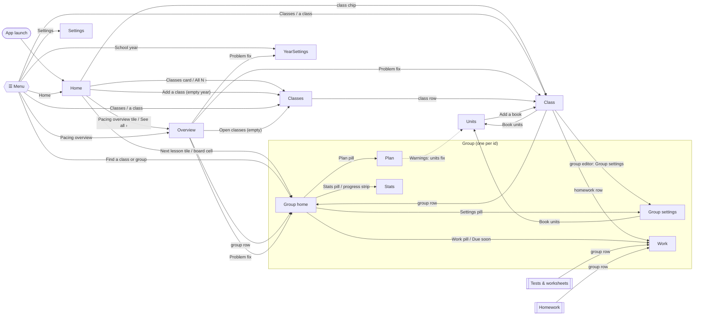

# Navigation graph

Every screen, menu, sheet and dialog in Course Pacer, and the control that leads to each. It is built from the code in `app/src/main/java/gr/edusuite/pacer/ui/`; the back-stack rules themselves are in [ARCHITECTURE.md](ARCHITECTURE.md) (Navigation). Labels are the English strings the app shows.

## Screen graph

Solid arrows push a screen. Dotted arrows open a sheet or dialog over the current screen. `goTo` (menu, search, switcher) returns to a screen already on the stack instead of stacking it again.

- **Back** (system or gesture) pops one screen; it closes an open menu, sheet or dialog first. Home is always the root, so Back on Home leaves the app.
- **Launch** always opens Home. The open group is saved, but launch ignores it.
- **Group to group**: opening another group from a group swaps it rather than stacking a second group.
- **Switching year** closes every year screen; **switching class** closes the old class's screens. Deleting something drops its screens from the stack.
- `Tests` and `Homework` are still routes, but no control opens them today. They list the class's groups, each linking to that group's Work page.

## Global controls

These appear on every screen except where noted.

| Control | Where | Does |
| --- | --- | --- |
| ☰ Menu | Top bar start; Home header. Hidden from 840dp (menu stays open) | Opens the drawer. A dot marks an available update ("Menu, update available") |
| Title ▾ ("Switch group") | Group screens' title | Opens the group switcher: search, recent groups, and groups or pages |
| ⚠ N warnings | Top bar, when count > 0 | Group screens: Warnings sheet. Pacing overview: Problems in this year. Class: Problems in this class |
| Undo | Top bar on Classes, Class, School year, Units, Tests, Homework and group screens | Undoes the last edit; repeat to go further back |
| ⋮ More options | Group screens' top bar | Opens the group menu |
| Undo snackbar | After deletes and actions | Undo for that action (Home, Settings and Pacing overview use only this) |

### Drawer (☰)

| Item | Goes to |
| --- | --- |
| Find a class or group (search, Clear search) | Matching groups by class and group name, accents ignored. Tap a hit: that group's home |
| Home | Home |
| Pacing overview (count of groups behind) | Pacing overview |
| Classes (expand or collapse) | The year's classes; each opens Class. "Classes" link opens Classes |
| School year | School year settings |
| Settings (update dot) | Settings |

Search and the year items show only while a year is open. "No match" shows when the search finds nothing.

### Group switcher (title ▾)

A sheet with a search, the last 4 groups opened this session (Recent), and:

- From **group home**: "Go to a group", listing the class's other groups. Picking one opens its home.
- From **Plan, Work, Stats or Group settings**: "Go to a page", listing the group's other pages.

## Screens

### Home

| Control | Does |
| --- | --- |
| New school year (no years) | New school year dialog: Name, Starts, Ends, Greek holidays switch, Create |
| Add a class (year without classes) | Classes |
| Next lesson tile | That group's home |
| Done (on the tile) | Marks that lesson done; Undo snackbar |
| Pacing overview tile | Pacing overview |
| Classes card, All N › | Classes |
| Class chip | That class |
| Board cell (class · group, behind count) | That group's home |
| See all › / N on pace | Pacing overview |
| Welcome guide | Create your school year, Not now, Got it; tips have Got it and Dismiss |

### Pacing overview

Group rows (status, lessons short) open the group. "Hide groups on pace" and "N on pace ›" fold the on-pace rows. The ⚠ button opens **Problems in this year**; each fix opens the class, the group or School year. With no classes: Open classes. On a tablet this is the list pane beside the open group.

### Classes

| Control | Does |
| --- | --- |
| Class row | Class |
| New class… | Dialog: name, Add |
| New collection… | Collection dialog (name and classes) |
| Collection ⋮ | Edit collection, Delete collection (Undo snackbar) |

### Class

| Control | Does |
| --- | --- |
| Edit | Class settings sheet: lesson length and pace, Book units, Reset all positions, delete class |
| Book units row (On/Off) | Units |
| Lead book choice | Sets the lead book |
| Book row | Book editor: Title, type, include (optional), Count in the lesson by default, First page, Last page, Skip pages, Finish by, units, Book units, Remove book |
| Add a book | Add a book sheet: Title, type (a supplementary book takes the pages to include), First page, Last page, Add |
| Group row | Group home |
| Group edit | Group editor: Name, weekdays, Next lesson, Group settings |
| Add group | Adds a group |
| Homework rows | That group's Work page |
| ⚠ Problems in this class | Each fix opens its screen |

### Units

Add a book (no books: goes to Class), lead book choice, per book: Add units / Edit (Add unit start pages, Fewer units, More units, Space evenly, Save) and Don't link.

### School year settings

Year chips switch the open year. Rename school year (Save), term dates, Add a day off (Add), Greek holidays, day-off rows (Remove, Undo), delete the year.

### Settings

Theme, palette (Bone or Saffron sets), New classes order, Help (show tips again), Updates (Download, See all changes, Check now, auto-check switch), Export… and Import… (Replace all, Add, Cancel), About.

## Group pages

### Group home

Today box (Done; "Pages taught" opens the record sheet), progress strip (Stats), Due soon (Work), and pills **Plan · Work · Stats · Settings**. In large text the pills become rows. On a tablet, group home shows as Plan.

### Plan

| Control | Does |
| --- | --- |
| Tap a lesson's tick | Marks it done or not done |
| Long-press a lesson (or its TalkBack actions) | Lesson menu, below |
| Weekly view / Monthly view | Groups the list; month view has Previous month and Next month |
| N earlier lessons › / Hide earlier lessons | Shows or folds taught lessons |

**Lesson menu.** Items appear only where they apply:

- Add homework…, Edit homework: *name*…, Delete homework: *name*
- Edit extra lesson…, Delete extra lesson
- Add *book* pages… (supplementary books): opens the page chooser (Apply, Cancel; Keep these pages, Don't use this lesson)
- With a custom plan: Change planned pages… or Plan a lesson here…, Add a lesson before, Move earlier, Move later, Re-pace from here, Remove lesson
- Record what I taught… (past lessons), Done up to here, Not done from here

### Work

Add assignment opens the assignment editor (Schedule in class, Set as homework, Skip). Each row's ⋮ ("Options for *name*"): Edit assignment, Remove (Undo snackbar).

### Stats

Own pace (apply creates a custom plan), Resume at page, More stats › in large text.

### Group settings

Next lesson, End date (optional), days off (Day off, Options ⋮: Edit, Delete; inherited days are read-only), Greek holidays, skipped pages per book, extra book, units override, Book units (Units). Long-press a book: Finish by, Use class date, Remove from this group / Add back. Delete group.

### Group menu (⋮)

Make a custom plan (large text), my-plan toggle, Re-pace untouched lessons, Copy to… (other groups), Delete my plan, Own pace… (large text), Adjust catch-up…, Add extra lesson…, Copy, Share, Print, Tips. Print opens the Print dialog: this group, the whole class or Every group this year, margins, Print.

### Warnings sheet (⚠)

Each warning carries its fix: Catch up (catch-up sheet), Bring in step, Re-pace, Fit to term, Tidy, Edit extra lesson…, and Book units (Units, or the unit revision sheet with Remove revision).

## Outside the app

- **Share** opens the Android share sheet; **Copy** puts the schedule on the clipboard.
- **Print** hands the sheet to the Android print service.
- **Export… / Import…** use the system file picker.
- **Download** and **See all changes** open the browser at the GitHub release.
- A data-read failure shows a recovery notice with **Save a copy…** and **Close**.
