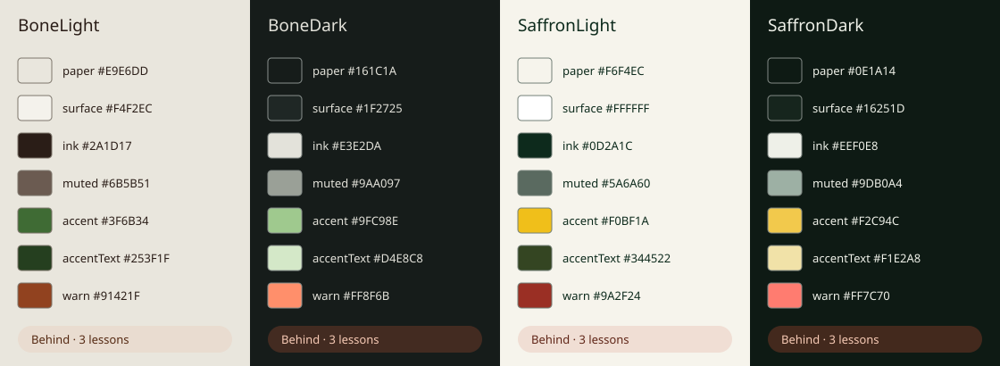
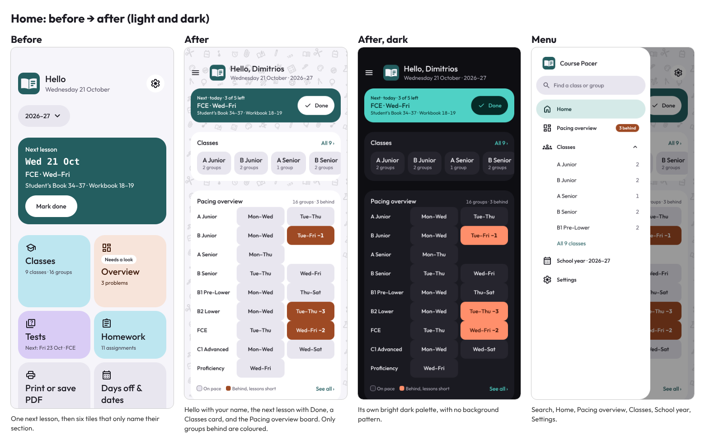
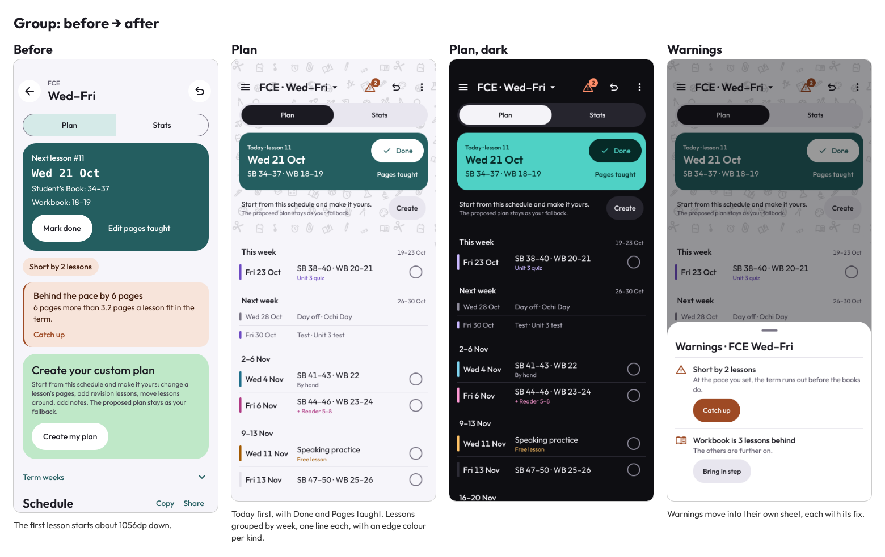
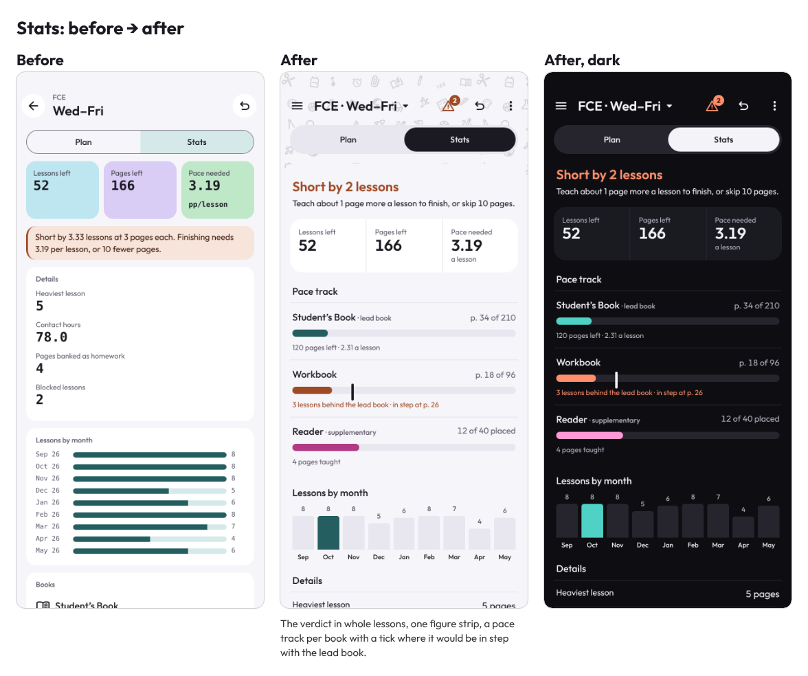
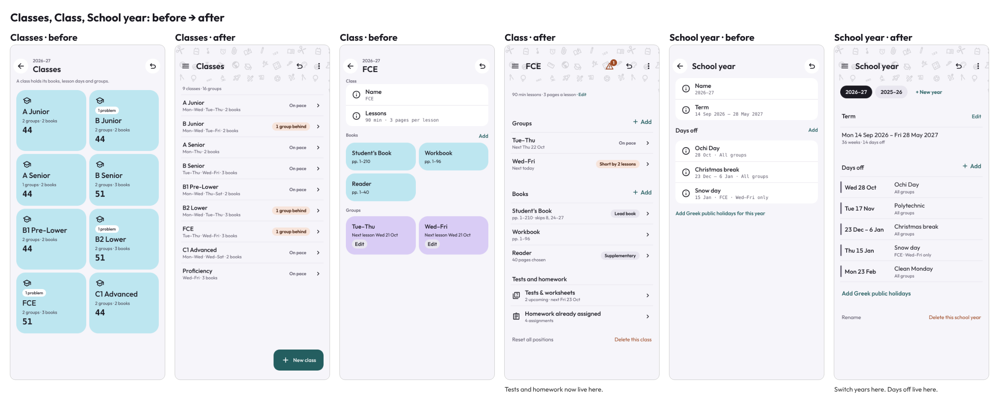
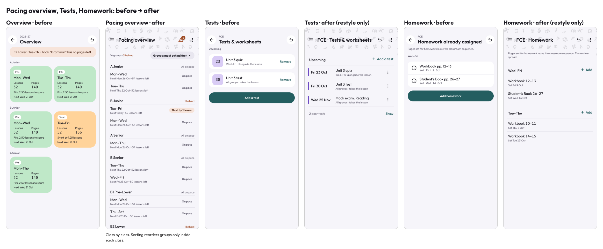
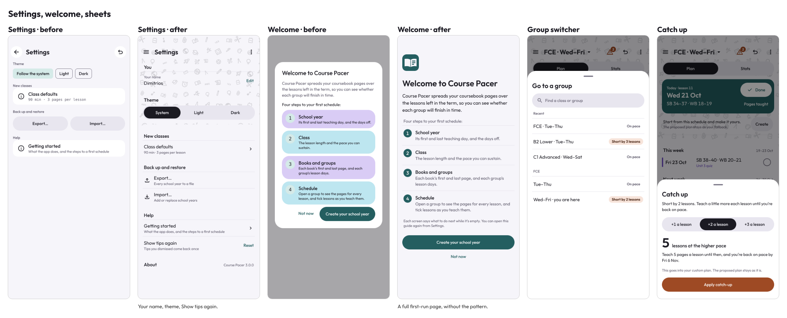
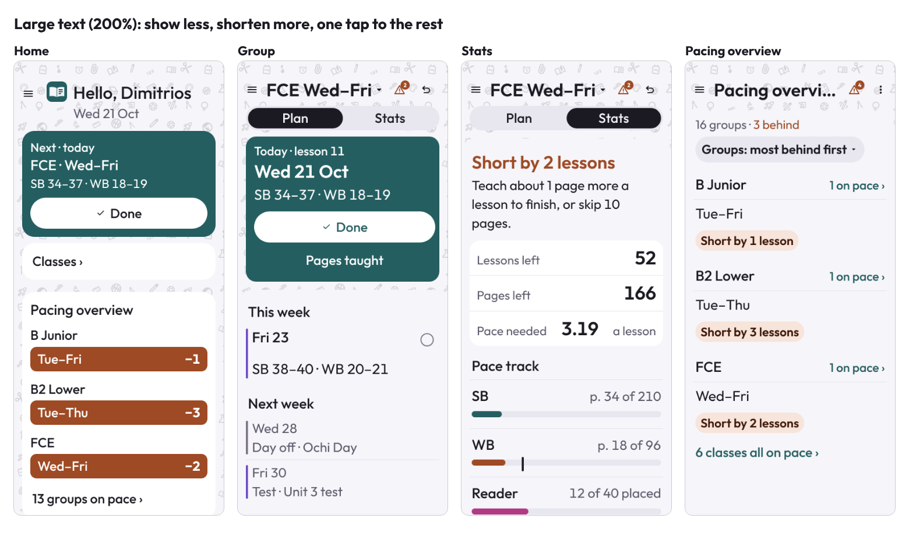
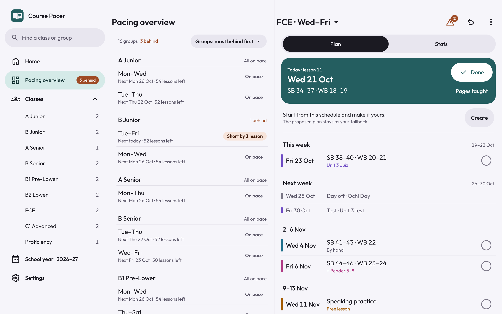

# Course Pacer design language

> **Status: approved, being built.** Agreed with the owner on 2026-10-21. It ships in 3.1.0 to 3.6.0 following
> `docs/superpowers/plans/2026-10-21-app-redesign.md`. **Tokens and type landed in 3.1.0** (PR1): the dark set, the edge
> tokens, `Figures`, the 48dp segmented switch and targets, and the pale status pill (D1, D2, D8, D10, D11's pills).
> **Navigation landed in 3.2.0** (PR2): the ☰ menu, the group switcher, the Warnings sheet and the Pacing overview
> name (D5 on phones, D7). **Home landed in 3.3.0** (PR3): "Hello, name", the next-lesson bar, the Classes card and
> the Pacing overview board (D3, D4, D11's board cells), with the year switcher moved to School year. **The group
> screen landed in 3.4.0** (PR4): today's box, the custom-plan line, the lesson ledger in week sections with edge
> colours, the ⋮ menu, and Stats with the pace track (D6, D8 on lesson rows). **The other screens landed in 3.5.0**
> (PR5): Classes, Class, School year, Pacing overview (sorted inside each class, problems in the warning sheet), Tests
> and Homework as ledger rows with edges and one status mark, the full-page welcome (D9) and Print's three choices. **Large text and the tablet landed in 3.6.0** (PR6 and PR7 together): the reflow and
> "show less" rules from font scale 1.5, and the list and detail panes with a permanent menu (D5 on tablets). **The
> background pattern (D12) was dropped by the owner before it was built**, so there is no pattern, no `SolidSheet` and
> no `PatternBackground`, and the before/after boards still show it. The rest of the design is built. **Selectable Bone and Saffron palettes land in 3.8.0** as D13. The full design is `docs/superpowers/specs/2026-10-21-app-redesign-design.md`.

`docs/EDUSUITE_STYLE_GUIDE.md` stays the shared EduSuite guide and a byte-for-byte copy of the one in Course Invoicer.
This file records where Course Pacer departs from it. Every departure is Pacer-only for now. Together they are
candidates for the next suite guide, which Course Invoicer may adopt later, one decision at a time.

## The idea

A plain ledger with one focal point per screen. Today's lesson always comes first. Lists are one line per item on
hairline rows, with few boxes. Colour is for what needs attention: groups behind and the kind of each lesson. Figures
are whole lessons, rounded up. The look is bright and friendly, and precise like an instrument.

## Departures from the shared guide

| # | Guide | Course Pacer |
|---|---|---|
| D1 | §2.1/§2.2/§10: the dark set is deep, low-light versions | Deep green-tinted grounds and soft ink in both Pacer palettes (D13) |
| D2 | §1/§3: figures in monospace | Outfit with tabular figures |
| D3 | §6 Home header: "Hello" with a Settings button | "Hello, name" with the date and year. ☰ opens the menu. Settings is in the menu. |
| D4 | §6 Tile grid (bento) on Home | Next-lesson bar, Classes card and Pacing overview board |
| D5 | §15: a back arrow on every screen; no drawer | ☰ menu on every screen, a permanent drawer on tablets. System Back still works. |
| D6 | §6 List row: a leading icon | Ledger rows with no icon. Edge colours mark the kind. |
| D7 | §6 Warning banner on the screen | A warning button with a count, and the Warnings sheet |
| D8 | §2: no kind colours | Six non-violet lesson-kind edge tokens, with words retained (D13) |
| D9 | §6 GuideCard or dialog for the welcome | A full first-run page |
| D10 | §6 segmented control | A filled segmented switch with an ink selected side, 48dp |
| D11 | §2.2 tiles carry status (mint for done) | On-pace is neutral; behind keeps its word and pale pill, with rust/red distinct from the accent. |
| D12 | §1 Flat, colour blocks only | ~~A light-mode background pattern of school icons, under solid sheets~~ Dropped by the owner (3.6.0): the app stays flat, with no pattern |
| D13 | §2 shared light neutrals, tiles and accent | Pacer-owned Bone & green (default) and Saffron & ink, each light/dark. No dynamic colour. The suite guide still shows the old palette; other suite apps may adopt these later. |

## Tokens

The palette is saved outside undo and changes the whole Compose theme immediately. Surface steps sit close to their ground. Saffron is a fill, never text on pale paper; foreground controls use accentText, derived from onAccentSoft. Legacy tile names remain for source compatibility, with new non-violet values. Values were tuned for text and edge contrast, edge separation and warning/accent hue separation. The Saffron warnings use a redder rust to reach the required 40° hue separation while keeping the seed accent.

| Token | Bone light | Bone dark | Saffron light | Saffron dark |
|---|---|---|---|---|
| paper | `#E9E6DD` | `#161C1A` | `#F6F4EC` | `#0E1A14` |
| surface | `#F4F2EC` | `#1F2725` | `#FFFFFF` | `#16251D` |
| surfaceContainer | `#E1DED4` | `#2A3330` | `#E9E9DF` | `#24352B` |
| line | `#CDCABF` | `#3B4540` | `#D5D9CE` | `#35493B` |
| outline | `#7D766C` | `#89908D` | `#738078` | `#828A85` |
| muted | `#6B5B51` | `#9AA097` | `#5A6A60` | `#9DB0A4` |
| ink | `#2A1D17` | `#E3E2DA` | `#0D2A1C` | `#EEF0E8` |
| tileLilac | `#D7DFCA` | `#303E31` | `#F4E7AA` | `#454025` |
| tileMint | `#E0DCD1` | `#3A3C34` | `#DCE7D9` | `#2D3F30` |
| tileSky | `#D1DEE0` | `#2C3E42` | `#DCE7E5` | `#293D39` |
| tileApricot | `#E5D9CB` | `#45382D` | `#EBE3CE` | `#413B2A` |
| tilePink | `#DDE3BF` | `#3B4128` | `#E1E2D9` | `#363C32` |
| onTile | `#2A1D17` | `#E3E2DA` | `#0D2A1C` | `#EEF0E8` |
| onTileMuted | `#574D42` | `#C6C9BE` | `#42574A` | `#C8D4C8` |
| warn | `#91421F` | `#FF8F6B` | `#9A2F24` | `#FF7C70` |
| onWarn | `#F4F2EC` | `#3A1206` | `#FFFFFF` | `#3A1206` |
| warnSoft | `#E9DCD0` | `#432B21` | `#F0DED4` | `#43291D` |
| onWarnSoft | `#542811` | `#F8CBB6` | `#5F2416` | `#F8CBB6` |
| ok | `#37622F` | `#9FC98E` | `#315F40` | `#A1CAA3` |
| onOk | `#F4F2EC` | `#0F1A0C` | `#FFFFFF` | `#102719` |
| okSoft | `#D9E1CF` | `#2C3F29` | `#DEE8D9` | `#283F2D` |
| onOkSoft | `#233C1E` | `#CEE7C0` | `#1D4028` | `#D7EACF` |
| accent | `#3F6B34` | `#9FC98E` | `#F0BF1A` | `#F2C94C` |
| onAccent | `#F4F2EC` | `#0F1A0C` | `#0D2A1C` | `#0E1A14` |
| accentSoft | `#D9E3D0` | `#2D4129` | `#F4E7AE` | `#423C1E` |
| onAccentSoft | `#253F1F` | `#D4E8C8` | `#344522` | `#F1E2A8` |
| edgeTest | `#994B39` | `#D77D60` | `#9A2F24` | `#D77D60` |
| edgeDayOff | `#7D766C` | `#89908D` | `#738078` | `#828A85` |
| edgeEdited | `#3F6B34` | `#9FC98E` | `#315F40` | `#F2C94C` |
| edgeHand | `#2D6C84` | `#77B2C2` | `#2D6C84` | `#77B2C2` |
| edgeFree | `#896900` | `#D8C26A` | `#896900` | `#9FC98E` |
| edgeSupp | `#414700` | `#E0DDD0` | `#414700` | `#E0DDD0` |

The launcher icon and first-frame window background are static and always Bone (the background follows light/dark). Saffron users see that neutral Bone background only until Compose draws; it contains no launch text. The in-app logo follows the chosen palette, using accent and onAccent. The Home next-lesson and Group today panels are neutral so the accent stays concentrated in small controls.

Text is at least 4.5:1 and outlines/edges at least 3:1; pairwise edge RGB distance is at least 60. Every set excludes violet/indigo. `docs/PACER_ACCENT_CONTRAST.md` lists all measured pairs. 

## Rules

- **Figures:**
  - Lesson counts are whole lessons rounded up, and anything under 1 shows as 1. One verdict feeds every label, so a
    group reads the same everywhere.
  - Pages per lesson keep two decimals, and only on Stats.
- **Status:** one mark per row. On pace is neutral. Behind is rust (a filled cell on the board, a pale pill in lists).
- **Lesson kinds:** a 4dp edge in the kind's token, and the words still say the kind.
- **Undo:** in the top bar only where school-year data changes. Timed snackbars show an emptying bar, with no words.
- **Large text** (font scale 1.5 and up, `largeText`):
  - layouts reflow: buttons go full width under their text, and a row's date sits over its pages;
  - screens show less: Home and Pacing overview list only the groups behind, with "N groups on pace ›", "N on pace ›" and "N classes all on pace ›"; Stats puts the months and details behind "More stats ›"; the custom-plan line moves to ⋮;
  - everything hidden is one tap away, and a top bar's title is cut short with "…".
- **Touch targets** are 48dp or more, text links included.
- **Tablets** (the window's width in dp, no window-size library):
  - from 600dp, Pacing overview and the open group share the window as a list pane and a detail pane, with one set of actions in the detail pane's bar and the open group highlighted in the list;
  - from 840dp the menu is a permanent drawer, so there is no ☰;
  - Back closes the detail pane first (`Nav.panes`).

## Pictures

Before/after boards of the approved design are in `docs/images/redesign/`. Their classes and figures are sample data.

## Popup corners (3.8.1)

Dropdown menus use the shared `PacerDropdownMenu` with fixed 12dp corners. They must not inherit the percentage-rounded pill shape: on tall menus it cuts through the first and last option labels. Buttons and chips retain their pill shapes.
